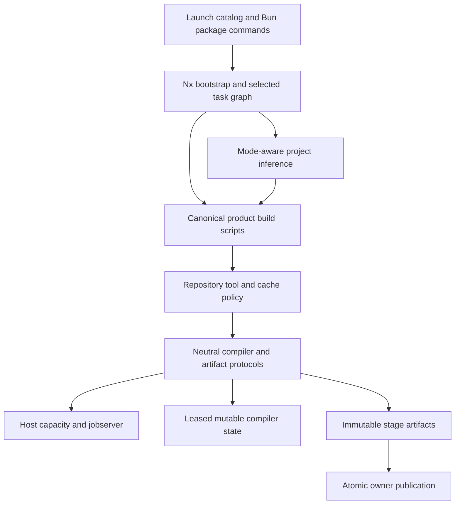

# Modular Build Architecture

## Ownership And Layers

The neutral process module owns strict prototype/release admission, optimization policy, worker capacity, subprocess cancellation, compiler protocols, and artifact publication. Repository extensions choose cache locations and authored project policies. Nx owns dependency scheduling, mode inheritance, source ownership and task artifact caching. Product scripts choose product-specific inputs and composition. Compiler leaves bypass root audit and job-discovery code.

The workspace build target is a graph completion entrypoint. It must not acquire a compiler lease or hash broad native ownership itself. Its prerequisites own compiler work and outputs. Individual compilers report progress, consume admitted resources, and publish only after completing their private staging directory.

## Cache Identities

| Store | Identity and sharing | Mutation ownership |
| --- | --- | --- |
| Nx task artifacts | Selected mode, source closure, external package closure, compiler/configuration | Nx task cache |
| Native Cargo intermediates | Toolchain, central authored profile/configuration, compiler store, actual profile | Shared profile lease and jobserver |
| Compiler capacity | Repository host lease namespace | Shared single-core cohort or queued whole-host admission; inherited child budgets |
| Web and TypeScript state | Owner, tool/version, platform, configuration, mode | Host-first admission followed by owner compiler-state lease |
| Vite server optimizer | Private server identity seeded from shared owner state | Private updates; short shared publication lease |
| Published native/web/packages | Owner and mode | Private staging then atomic publication |
| Consumer active export views | Current successful canonical mode output | Explicit leased projection; affected Nx tasks cannot skip projection |
| Go executables | Mode and exclusive binary owner directory | Owned staging cannot remove sibling executable owners |

Every actual build selects prototype or release before compiler options or output identities are constructed. Fixed-mode target names remain explicit mode selections; dev session namespaces represent serving state and map to prototype compiler artifacts. No compiler alias accepts dev or ship.

## Worker Allocation

Independent compiler graphs enter the same repository `.cache/framework/leases` host namespace. Single-thread TypeScript declaration and checking phases reserve one core through a bounded shared cohort. A waiting whole-host compiler blocks later cohort members, and abandoned owners release both gate and core claims through the existing SQLite lease protocol. Mutable compiler-state ownership uses separate leases; it cannot establish an independent host gate. Bundle, declaration, and checking phases release their capacity claims between phases. Independent compiler graphs enter shared host admission. Rust compilers and compatible stages use a common jobserver pool. Jobs declare their worker protocol in the language-neutral schema. Jobserver-aware clients can borrow pool tokens; other compilers first reserve tokens and inherit only that worker count. Reserved children do not receive jobserver flags, preventing them from borrowing capacity a second time. A nested driver cannot create a pool larger than its inherited admission. Tools whose worker count cannot be controlled reserve the whole pool before starting. Queue-head accumulation prevents new work from taking those slots while existing work finishes; cancellation returns partial grants. Essential in-process bundlers receive explicit stage environments and refuse partial host admission. Cancellation and completion release held slots. Any path that needs both capacity and mutable compiler state acquires capacity first; holding state while reacquiring capacity is prohibited. Stateless artifact builds own private snapshots and use publication leases rather than holding unused mutable-state locks.

## Verification Boundaries

This is a decision and ownership record. Actual test and build results, wall times, platform coverage, and unresolved checks belong in the workstream reports and integration record. A graph admission check is not a full monorepo build; a task cache hit is not a launcher performance measurement.
