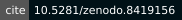
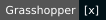
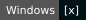
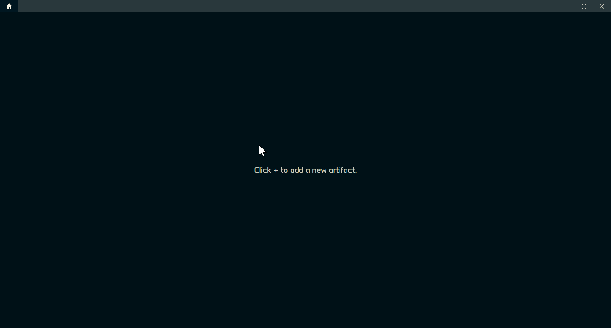
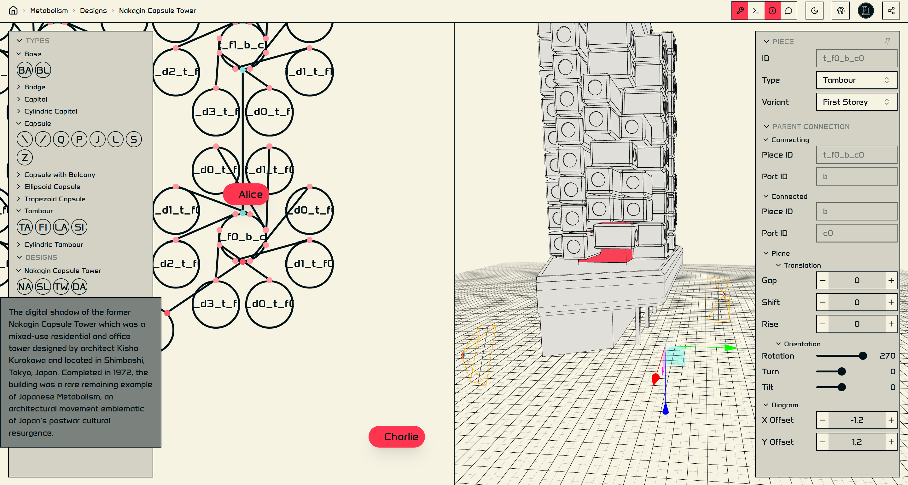
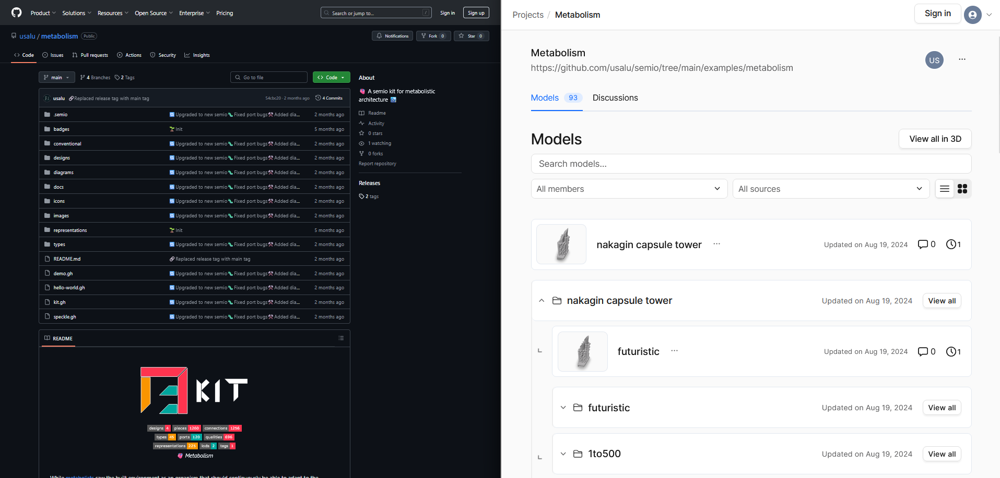
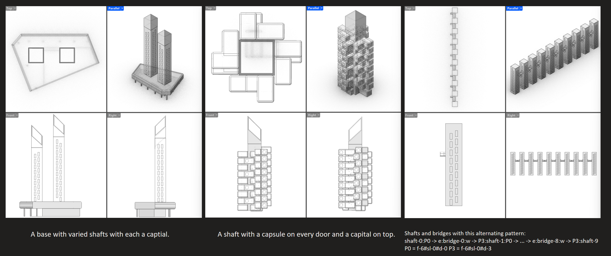
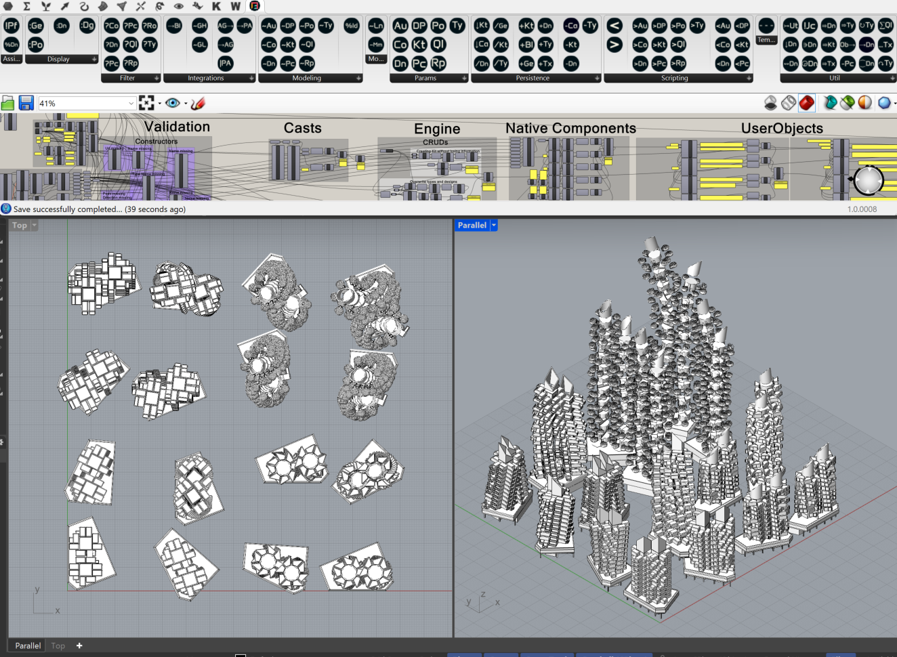
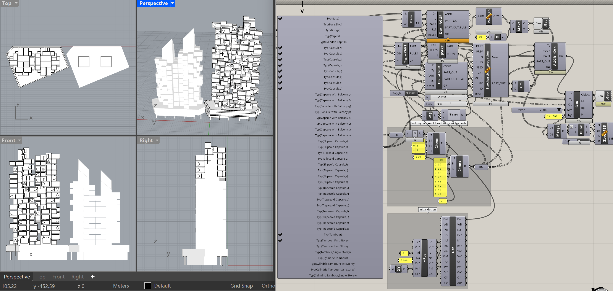
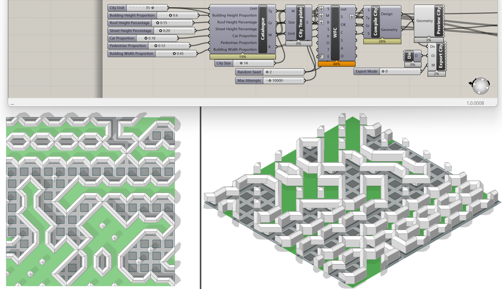

<p align="center">
    <a href="https://docs.semio-tech.com">
      <picture>
          <source media="(prefers-color-scheme: dark)" srcset="🧰️framework/🔨️modules/🖼️assets/🪧️logos/🪧️logo/🌙️dark/🖋️vector.svg">
          <source media="(prefers-color-scheme: light)" srcset="🧰️framework/🔨️modules/🖼️assets/🪧️logos/🪧️logo/☀️light/🖋️vector.svg">
          
      </picture>
    </a>
    <br/>
    <a href="https://play.semio-tech.com"></a>
    <a href="https://docs.semio-tech.com"></a>
    <a href="https://js.semio-tech.com"></a>
    <a href="https://discord.gg/m6nnf6pQRc"></a>
    <br/>
     <a href="https://github.com/usalu/semio"></a>
    <a href="https://doi.org/10.5281/zenodo.8419156"></a>
    <a href="https://choosealicense.com/licenses/agpl-3.0/"></a>
    <br/>
    <a href="https://eg-ice-25.semio-tech.com"></a>
    <a href="https://doi.org/10.17868/strath.00093288"></a>
    <a href="https://eg-ice-23.semio-tech.com"></a>
    <br/>
    <a href="https://play.semio-tech.com"></a>
    <a href="https://www.grasshopper3d.com/"></a>
    <a href="https://www.microsoft.com/windows/windows-11"></a>
    <a href="https://apple.com/macos"></a>
    <br/>
    <a href="https://www.typescriptlang.org/"></a>
    <a href="https://www.python.org/"></a>
    <a href="https://learn.microsoft.com/en-us/dotnet/csharp/"></a>
    <br/>
    <br/>
    <i>🧩️ Design-Information-Modeling for Kit-of-Parts 🏘️ </i>
</p>
<br/>

You want to 🧩️ the next 🏘️🏛️🏢️🏭️🏫️🏨️⛪️🕌️ with 🤖️? But 📐️🔢️🗣️👥️🖱️⌨️ takes all your ⌚️? Then try to 🧠️ the 🧬️ and let compose 💉️🖥️✒️🖨️🪄️🚀️

# 👋️ Hello contributor

> [!NOTE]
> Are you a user or new to compose? Then you might want to first check out our [docs](https://docs.semio-tech.com) 📖️

Glad to see you!

Let me walk you through 🚶️

# 📑️ Overview

1. [🛍️ Products](#%EF%B8%8F-products-)
   - [✏️ sketchpad](#%EF%B8%8F-sketchpad-)
   - [👥️ studio](#-studio-)
   - [☁️ cloud](#%EF%B8%8F-cloud-)
   - [🤖️ assistant](#-assistant-)
   - [🦗️ 🦗️compose.gh](#-composegh-)
   - [🦏️ 📐️compose.3dm](#-compose3dm-)
   - [🐝️ compose.wasp](#-composewasp-)
   - [🦌️ compose.monoceros](#-composemonoceros-)
   - [🐞️ compose.ladybug](#-composeladybug-)
1. [🦑️ Repo](#-repo-)
   - [⚖️ Principles](#-principles-)
   - [🏗️ Technologies](#-technologies-)
     - [👤️ compose](#-compose-)
     - [🧰️ repo](#-repo-)
     - [🔬️ coda](#-coda-)
     - [🧩️ elements](#-elements-)
   - [🔀️ Git](#-git-)
     - [🎛️ Dashboard Git](#-dashboard-git-)
     - [🔍️ ripgrep](#-ripgrep-)
     - [💬️ Discord](#-discord-)
     - [📢️ Release](#-release-)
     - [🏷️ Tag](#%EF%B8%8F-tag-)
     - [🌿️ Branch](#-branch-)
     - [🗃️ Commit](#%EF%B8%8F-commit-)
   - [🔀️ Tools](#-git-)
1. [🧑️💻️ Development](#-development-)
   - [🖥️ Systems](#-systems-)
     - [🪟️ Windows](#-windows-)
     - [🍎️ macOS](#-macos-)
     - [🐧️ Linux](#-linux-)
   - [🔨️ Build](#-build-)
   - [🤖️ AI](#-ai-)
     - [🛠️ Uses-Cases](#-uses-cases-)
       - [⚖️ Decision Making](#-decision-making-)
       - [🔁️ Refactoring](#-refactoring-)
       - [🐛️ Bug Fixes](#-bug-fixes-)
     - [⌨️ Tools](#-tools-)
     - [🌐️ Web-Chat](#-web-chat-)
       - [❄️ ChatGPT](#-chatgpt-)
       - [🌟️ Gemini](#-gemini-)
       - [AI studio](#-ai-studio-)
     - [⌨️ CLI](#-cli-)
       - [⌨️ Claude Code](#-claude-code-)
       - [🧾️ Codex](#-codex-)
     - [☁️ Cloud](#-cloud-)
       - [🦑️ Jules](#-jules-)
     - [🔍️ Agents](#-agents-)
       - [↕️ Reorderer](#-reorderer-)
       - [🔁️ Formatter](#-formatter-)
     - [🤖️ Models](#-models-)
   - [🔄️ CI/CD](#-cicd-)
1. [💯️ Brand](#-brand-)
   - [✍️ Concept](#%EF%B8%8F-concept-)
     - [✅️ Do](#-do-)
     - [❌️ Dont](#-dont-)
   - [🌈️ Colors](#-colors-)
     - [🥇️ Primary](#-primary-)
     - [🥈️ Secondary](#-secondary-)
     - [🥉️ Tertiary](#-tertiary-)
     - [⚫️ Dark](#-dark-)
     - [⚪️ Light](#-light-)
     - [🩶️ Gray](#-gray-)
   - [📄️ Typography](#-typography-)
     - [🔡️ Typesetting](#-typesetting-)
   - [👀️ Visual elements](#-visual-elements-)
1. [⚖️ License](#-license-)
1. [🔒️Security](#-security-)
1. [✨️ Contributors](#-contributors-)
1. [📊️ Stats](#-stats-)

# 🛍️ Products [↑](#-overview)

> Do you wonder how compose is interoperable? The reason is a shared [specification](#-requirements-) 🪢️

> Build the products from this checkout with `repo dashboard run workspace:setup`. Every release
> binary named below lands under its product's `dist/`. The checked-in CI workflows declare native
> Windows, macOS, Linux and devcontainer dashboard checks; hosted execution remains unverified.


## ✏️ sketchpad [↑](#%EF%B8%8F-products-)

[sketchpad](#%EF%B8%8F-sketchpad-) is a simple-to-use, accessible and browser-based user interface for compose🖱️

It is the digital pencil for sketching plans and digital scalpel for building models in compose ✍️



**Getting started** — the browser shell, hosting every plugin in one window:

```bash
repo dashboard run workspace:setup                                           # once, after cloning
repo dashboard run playground:s --param renderer=react --detach --wait-ready  # prints http://127.0.0.1:6070/
```

`semio …` is shorthand for `repo dashboard …` (see *The four golden paths* below). The
command activates the shell first (the cached `activate-s-react-dev` prerequisite stages and compiles the
components) and then serves it. The first activation compiles every plugin to WebAssembly and takes tens of
minutes; later starts take seconds. The same command is a row of the dashboard (`repo dashboard`,
`Ctrl+B n`, type `s react`), where `renderer`, `example`, `user-slot` and the hub are parameters. Another
plugin is another variant: `playground:draw` activates and serves only that plugin, a first look in a fraction
of the time.

## 👥️ studio [↑](#%EF%B8%8F-products-)

A studio is a synchronous collaboriation environment for teams to work together in compose 🤝️



**Getting started** — two people in one document needs the hub, the server half of semio:

```bash
repo dashboard run os-hub:dev-secure-suite --detach --wait-ready   # hub + React `s` + native + MCP children, one credential each
repo dashboard run os-hub:dev --detach --wait-ready                # the hub alone, loopback, data root ./.🧬semio/🌐hub
```

That is the *development* topology: supervised, loopback-only, and it will not start as a bare
process. For a server — a network bind, a reverse proxy, the first user, backups — build the release
binary and read [`🌎️hub/README.md`](🌎️hub/README.md) from the top; its opening table is the gate that
decides whether your hub boots at all.

```bash
repo dashboard run os-hub:build              # → 🌎️hub/📦️packages/🦀️rust/dist/build/os-hub
repo dashboard run workspace:publish -- os-hub     # → dist/publish/os-hub-<version>-<platform>-<arch>.tar.gz
```


## ☁️ cloud [↑](#%EF%B8%8F-products-)

Use any file-hosting platform as an asynchronous Common-Data-Environment 📁️



**Getting started** — storage *is* the hub's own store; there is no second service to run. One
directory, `OS_HUB_DATA`, holds the event-sourced documents, the artifact chunk store, the identity
database and the published trusted catalog:

```bash
export OS_HUB_DATA=/srv/semio-hub/data
tar -czf hub-backup.tgz -C "$OS_HUB_DATA" .   # with the hub stopped, this is the whole backup
```

The document store (`OS_HUB_STORAGE_BACKEND`) is `fs` by default and may be `sqlite`, `postgres` or
`neo4j`; the identity store (`OS_HUB_DIRECTORY_BACKEND`) is `sqlite` by default and chosen
independently. Every connection variable, and which of them a given backend requires, is in
[`🌎️hub/README.md`](🌎️hub/README.md).


## 🤖️ assistant [↑](#%EF%B8%8F-products-)

The assistant helps you on every step in the design process with compose ✍️



**Getting started** — the assistant is *your own* AI client. This project ships no model and calls no
model provider; it ships an MCP server that hands your client semio's own capabilities — open and
create artifacts, prepare and invoke actions, snapshot, undo/redo, transactions, inference — against
a folder of your work or against a hub space, and bridges them into a semio window you already have
open.

```bash
repo dashboard run @semio-tech/framework-os-mcp-rs:build-release
# → 🧰️framework/🛍️products/💻️os/🔨️modules/🌉️mcp/📦️packages/🦀️rust/dist/build-release/semio-os-mcp
```

**Claude Code** — a `.mcp.json` in the project you want it available from (the repo checkout is the
`cwd`; the folder is *your* work, anywhere on disk):

```json
{
  "mcpServers": {
    "semio": {
      "type": "stdio",
      "command": "/Users/you/src/semio/🧰️framework/🛍️products/💻️os/🔨️modules/🌉️mcp/📦️packages/🦀️rust/dist/build-release/semio-os-mcp",
      "args": [
        "stdio",
        "--folder", "/Users/you/Documents/my-semio-space",
        "--scopes", "workspace.read,artifact.read,artifact.write,inference.execute,ui.observe,ui.control"
      ]
    }
  }
}
```

**Claude Desktop** — `claude_desktop_config.json` (macOS
`~/Library/Application Support/Claude/claude_desktop_config.json`, Windows
`%APPDATA%\Claude\claude_desktop_config.json`). Desktop takes no `cwd`, so the absolute binary path
is the only form that works:

```json
{
  "mcpServers": {
    "semio": {
      "command": "/Users/you/src/semio/🧰️framework/🛍️products/💻️os/🔨️modules/🌉️mcp/📦️packages/🦀️rust/dist/build-release/semio-os-mcp",
      "args": [
        "stdio",
        "--folder", "/Users/you/Documents/my-semio-space",
        "--scopes", "workspace.read,artifact.read,artifact.write,inference.execute,ui.observe,ui.control"
      ]
    }
  }
}
```

Change the two paths, restart the client, and ask it to list semio's capabilities. To work in a hub
space instead of a folder, swap `--folder <dir>` for `--hub <url> --space <id> --credential-file
<path>`, where the credential file is the one the *Agent delegations* panel of a signed-in semio
window downloads for you. Both shapes, every tool, the approval model and the other clients are in
[the MCP README](🧰️framework/🛍️products/💻️os/🔨️modules/🌉️mcp/README.md).


## 🦗️ [🦗️compose.gh](https://docs.semio-tech.com/manual/grasshopper) [↑](#%EF%B8%8F-products-)

A batteries-included [Grasshopper](https://www.grasshopper3d.com) program for compose ⚡️



## 🦏️ 📐️compose.3dm [↑](#%EF%B8%8F-products-)

A Grasshopper-based integration of [Rhino](https://www.rhino3d.com) and compose 🔀️

## 🐝️ compose.wasp [↑](#%EF%B8%8F-products-)

A Grasshopper-based integration of [Wasp](https://www.food4rhino.com/en/app/wasp) and compose 🔀️



## 🦌️ compose.monoceros [↑](#%EF%B8%8F-products-)

A Grasshopper-based integration of [Monoceros](https://monoceros.sub.digital) and compose 🔀️



## 🐞️ compose.ladybug [↑](#%EF%B8%8F-products-)

A Grasshopper-based integration of [Ladybug](https://www.ladybug.tools) and compose 🔀️

# 🦑️ [Repo](https://github.com/usalu/semio) [↑](#-overview)

This git repo has <strong>everything</strong> that exists in the open compose ecosystem 🤯️

## ⚖️ Principles [↑](#-repo-)

Let's start with the rules of thumbs that this codebase was built with 🫰️

<details>
<summary><strong>💾️ If something can be written in a single file, then it probably should ✅️</strong></summary>

I know, the urge to <strong>tidy</strong> up or <strong>separate</strong> things is big 🗃️

But try to withstand it 🫥️

Out of my experience, it makes development slower, not faster 🐌️

A single file is easier for humans and computers to understand 💡️

You will be surprised

- by editing source directly in the dashboard’s [Workspace Files](🧰️framework/🛍️products/🦑️repo/🔨️modules/🎛️dashboard/README.md#-daily-work) 📂️
- by the hassle-free [context selection](#-browser-) for your ai agent 🖱️
- by the smooth refactor experience by just going top-to-bottom ⬇️
- by the beautiful diff for your next code review 🔍️
- by the clean git-history when you try to find a certain change 🔁️

</details>

<details>
<summary><strong>🙃️ Write and read code upside down ✅️</strong></summary>

Whenever something is referenced it should be above in the source code ⬆️

This means that all the building blocks (functions, classes, components, …) are first defined and then used below ⬇️

If you have a cyclic depedency (really?!) then put the object with lower complexity first 🥇️

This means that when you start with unknown code, it is probably best to start on the bottom and go upwards 🖱️

Why? LLMs, reflection, … , work best left-to-write 🤖️

[But Fill-in-the-Middle training is for free!?](https://arxiv.org/abs/2207.14255)

Yeah, if you consider only FiM for code, then yes 🆗️

But we want it all!

And is really so hard to start reading a from the bottom?

</details>

<details>
<summary><strong>📑️ If a class, function, component, … is only used once, then don't create it ❌️</strong></summary>

Probably, you learned to group code by classes, functions, components, … even if those definitions are only used once 🥇️

It hides the actual complexity and makes it harder to navigate the code 🔍️

</details>

<details>
<summary><strong>📺️ Inline everything that bearly fits onto the screen ✅️</strong></summary>

Smaller code, less tokens and easier diffs 🔍️

Your [ai](#-ai-) bill will be lower and the completions will resolve faster 🚀️

If you are not sure what the code does, you can ask [ai](#-ai-) 💬️

</details>

<details>
<summary><strong>🗣️ Don't use comments or if you must, only tag code at the end of the line ❌️</strong></summary>

Smaller code, less tokens and easier diffs 🔍️

Your [ai](#-ai-) bill will be lower and the completions will resolve faster 🚀️

If you are not sure what the code does, you can ask [ai](#-ai-) 💬️

</details>

<details>
<summary><strong>📑️ Use regions to structure your code ✅️</strong></summary>

Because you are not using classes, functions, components, … and you are inlining everything, your code will become long 📃️

To organize your code, you can use nested regions 📂️

In general, our files follow this structure:

1. Header
2. TODOs
3. Imports
4. Constants
5. CODE

</details>

<details>
<summary><strong>📁️ If a folder doesn't make your life dramatically easier, don't create it ❌️</strong></summary>

We all know this `./src/**` folder that has made it into a lot of starters 🚀️

Other than feeling cool about using hacky abbreviations, does it really help you to understand the bundle faster and work more efficient on it?

If your bundle contains hundreds of config file and other bundle folders at the root, maybe 🤔️

But most likely not ❌️

</details>

<details>
<summary><strong>📦️ Parts that belong together should be close in the source code  ✅️</strong></summary>

The default code organization is to group kind of structurally similar parts together 📂️

All models next to each other, all controllers next to each other, all errors next to each other, …

While this pattern supports structural refactoring, it makes plain extensions harder because you have to search through all the files 🔍️

Most changes are plain extensions and not structural refactors 🔄️

Further it has the advantage that every LLM-agent only has to predict one big block of code instead of plenty of small ones 🤖️

That's why frameworks like [React](https://react.dev/learn/thinking-in-react) exist or vendoring such as with [shadcn](https://ui.shadcn.com/docs) is more flexible than dependcenies such as with [bootstrap](https://getbootstrap.com/)

Cutting components vertically (a bit of logic with a bit of UI) instead of horizontally (all logic, all ui) requires more effort but enhances reusability 🔮️

</details>

<details>
<summary><strong>📄️ If multiple people work longterm on the same part, then one file for each part should be created ✅️</strong></summary>

Trust me, it will make collaboration much easier 🔀️

</details>

<details>
<summary><strong>🔮️ If you don't need an port because something is not likely to be extended soon, don't create it ❌️</strong></summary>

The main question is the port productive or not?

The pay-off of abstraction happens in the future 🛣️

Every extension profits from a clean port 🚀️

Most things are not extended 🪨️

If you change your architecture, just design proper ports for something concrete not something potential and reactor it ✍️

</details>

<details>
<summary><strong>🤏️ Repeating code is ok if it the repeated code is close in the source code ✅️</strong></summary>

We are past the time where we copy code for no reason 📃️

Actually repeated code can improve the attribute of your copilots suggestion 🤯️

The main question is how can your application grow?

If a change requires exponentially more duplication then you'll probably have to fix it 🛠️

If not, then you are probably good 👌️

</details>

<details>
<summary><strong>🏷️ Never use `type` for naming enums, ports, or types. Always use `kind` instead ✅️</strong></summary>

To avoid confusion with the native `type` concept in Compose, always use `kind` for naming enums, ports, or types that represent categories or classifications 🏷️

Examples: `ArtifactType` → `ArtifactKind`, `WindowType` → `WindowKind`, etc. 🔄️

</details>

<details>
<summary><strong>🤨️ Wait, no high-level advice and only plain numbers, files, folders or close line of codes?</strong></summary>

In our understanding, policy-of-thumbs are most useful when they are concrete 🔨️

Besides that we are sure you know about <strong>KISS</strong> (Keep-It-Simple-Stupid), <strong>DRY</strong> (Dont-Repeat-Yourself) vs <strong>WET</strong> (Write-Every-Thing-Twice)/<strong>RUG</strong> (Repeat-Until-Good), <strong>YAGNI</strong> (You-Aren't-Gonna-Need-It), <strong>SoC</strong> (Separation-of-Concerns), <strong>Avoid Premature Optimization</strong>, <strong>Law of Demeter</strong>, <strong>LCHC</strong> (Low-Coupling-High-Cohesion), <strong>SOLID</strong> (<strong>SR</strong> (Single Responsibility), <strong>OC</strong> (Open/Closed), <strong>LS</strong> (Liskov's Substitution), <strong>IS</strong> (Port Segregation), <strong>DI</strong> (Dependency Inversion)), …

But as always, the devil is in the details 😈️

Even if 95% of the codebase follows those principles, there are good reasons for the other 5% ⚖️

</details>

**🚩️ Don't worry, you'll figure out the possibilities and make the right choice for the specific problems ✅️**

## 🏗️ Technologies [↑](#-repo-)

The monorepo organizes its code into distinct technologies, each serving a specific domain in the ecosystem:

### 👤️ compose [↑](#-technologies-)

The core design-information-modeling technology, containing the main schema, engines, and domain implementations.

### [🧰️ repo](🧰️framework/🛍️products/🦑️repo/README.md) [↑](#-technologies-)

Infrastructure and tooling for the monorepo: the dashboard owns developer operations, native workspace files and editing, local history, Git and debugging; MCP servers provide agent access.

### 🔬️ coda [↑](#-technologies-)

A research project introducing an AI-first design assistant, bridging the semantic graph with interactive UI.

### [🧩️ elements](🧰️framework/🔨️modules/🖱️ui/README.md) [↑](#-technologies-)

Shared React UI components and layouts used across the browser-based applications within the monorepo.

## 🔀️ [Git](https://github.com/usalu/semio.git) [↑](#-repo-)

### 🎛️ Dashboard Git [↑](#-git-)

Choose **New Task** and search **Git Status**, **Git Diff**, **Git History**, **Git Revision** or **Line History**. Each form accepts the relevant workspace path or revision and keeps results in retained task output. Use **Workspace Terminal** for other Git operations; its input, output and process controls stay in the dashboard.

### 🔍️ ripgrep [↑](#-git-)

The devcontainer installs [ripgrep](https://github.com/BurntSushi/ripgrep) (`rg`) for zero-touch codebase searching 🔎️

It is the fastest way to find anything in this monorepo ⚡️

### 💬️ Discord [↑](#-git-)

Most git events are synchronized with our [repo channel](https://discord.com/channels/1338232508264747130/1339164626658525246) 💬️

It is perfect to find the latest activities and the history 🔍️

### 📢️ Release [↑](#-gitstyle-)

Every release contains a set of matching [requirements](#-requirements-), [bundles](#-bundles-), [examples](#-examples-) and [docs](#-docs-) 📦️

The release notes follow this format:

```
SYMBOL TITLE

COMPONENT
- SYMBOL SUMMARY [CONTRIBUTOR]
…
```

**Title symbols:**

- 🏗️ Foundational work
- 🛠️ Heavy work
- 🪛️ Minor work
- 🐛️ Major Bug fix

**Description symbols:**

- 🌱️ Started [not yet ready]
- ➕️ Added [ready]
- ⬆️ Updated
- 🔄️ Renamed
- 🔁️ Refactored
- 🐛️ Bug fix

Before every [native-build](#-release-) the [repo](#-repo-) is archived 📦️

### 🏷️ Tag [↑](#-gitstyle-)

We have two different types of tags:

- `rYY.MM-V` for [releases](#-release-) (e.g `r21.06-1`,`r23.07-2`,`r24.12-1`, `r25.07-1`, …)
- `COMPONENT-vMAJOR.MINOR.PATCH` for [bundles](#-bundles-) which follow the [semver](https://semver.org/) versioning scheme (e.g [`engine-v4.0.2`](#-composeengine-), [`sketchpad-v1.0.0`](#-composedesktop-), [`grasshopper-v5.4.0-beta`](#-composegrasshopper-), …)

### 🌿️ Branch [↑](#-gitstyle-)

The `main` branch is compressed (squashed history) and acts as the canonical integration branch 🗜️

If a release receives updates after `main` already progressed, create a parallel `release/rYY.MM-V` branch for that release and keep it compressed as well 🧵️

Every [contributor](#-contributor-) has their own `FIRSTNAME` general-purpose development branch 🛠️

Use [Dashboard Git](#-dashboard-git-) to inspect branch history and revisions.

Other branches are created for [bundles](#-bundles-), [specific features](https://github.com/usalu/semio/labels/enhancement) or [bug fixes](https://github.com/usalu/semio/labels/bug) 🐛️

Usually one person works on one feature at a time and hence the `-NAME` suffix 📛️

### 🗃️ Commit [↑](#-gitstyle-)

Commit messages follow this format:

```
MAIN-TASK-SYMBOL SUMMARY WORK-SYMBOL
```

The first symbol encodes the main task of the commit and the last symbol encodes the amount of work (`🪛️` < `🔨️` < `🛠️` < `🏗️`) 🧰️

<details>
<summary><strong>📦️ Commit as much as you like ✅️</strong></summary>

Are you worried about committing all those binary application files (`.zip`, `.gh`, `.blend`, `.glb`, `.3dm`, …) or the intermediate versions between your [ai](#ai) edits?

Well, normally you should be 💾️

But as we archive and squash all commits on every [native-build](#-release-) nothing is lost or polluted 💯️

</details>

<details>
<summary><strong>⌛️ Push around once an hour ✅️</strong></summary>

Pushing regularly keeps you extra safe from losing your work 🛟️

There are a few services (like [Discord](https://discord.com/channels/1338232508264747130/1339164626658525246)) that are automatically updating to what happens in the [repo](#-repo-) 🔄️

To keep our inbox notifications low, we try to push not more than once an hour ⬆️

</details>

# 🧑️‍💻️ Development [↑](#-overview)

Different [ecosystems](#-ecosystems-) need different tools 🧰️

## 🐳️ Devcontainer (Recommended) [↑](#-development)

The recommended way to develop is using the devcontainer which provides a consistent cross-platform environment 🖥️

**Prerequisites:**

- [Docker Desktop](https://www.docker.com/products/docker-desktop/) or compatible container runtime
- A devcontainer runtime implementing the checked-in `.devcontainer/devcontainer.json`

**Getting Started:**

1. Clone the repository
2. Start the checked-in devcontainer with your container runtime
3. Wait for container build and setup to complete
4. Run `repo dashboard` inside the container

Container creation runs `repo run workspace:setup`, which is the whole zero-touch bootstrap: every
language environment (`deps-javascript`, `deps-python`, `deps-cargo`, `deps-go`, `deps-dotnet`,
`deps-cpp`, `deps-browsers`, `deps-wasm` — which also installs `deps-trunk`, so both
`rust-toolchain.toml` wasm targets land — and `deps-tools`), then `setup-git` (git symlink checkout,
the root agent-instruction aliases, removal of legacy repo-managed hooks), `prepare` (generated
schema, styling tokens, assets, framework graph and the plugin registry catalog every `dev` route
resolves against) and both MCP server binaries (`repo-mcp:build`,
`@semio-tech/framework-os-mcp-rs:build`) so `.mcp.json` works on first attach. Every step probes
before it installs, so re-running it is cheap.

The devcontainer includes:

- Node.js 24 LTS, Go 1.26, Python 3.14, .NET SDK 8.0/9.0/10.0
- Rust via rustup with **no** image-pinned toolchain — `rust-toolchain.toml` is the single source of
  truth (currently `nightly-2026-07-20` with `wasm32-unknown-unknown` + `wasm32-wasip2`), installed on
  the first `cargo` invocation inside the repo
- The dashboard developer control plane
- Pre-configured development environment
- Port forwarding for dashboard services (8787, 6070, 6072/6073, 6066, 6067/6068, 6010, 6274/6277)

### 🏁️ The four golden paths

The dashboard is the only developer control plane. Start it with `repo dashboard`; its native
interactive view provides source editing, command forms, task output and process controls. Choose
**New Task** (`Ctrl+B n`), search an action, complete its form and start it. The native client reaches
the same workspace daemon when a scripted invocation is useful:

```bash
repo dashboard commands dev hub
repo dashboard run os-hub:dev --detach --wait-ready
repo dashboard run playground:s --param renderer=wgpu-wasm
repo dashboard tasks
```

The first start builds and installs the native dashboard. Later starts verify the installed source
identity and rebuild when needed, with progress and cancellation. Agents use the tool-neutral native
`repo` entry for builds, tests and repository operations (`repo run <project>:<target>`,
see [Build](#-build-)).
A dashboard command id is `<project>:<target>[:configuration]` for a repository build task, `playground:<variant>`,
`tool:<project>/<id>`, `compound:<project>/<id>`, `group:<project>/<id>`,
`ticket:<ticket id>/<tool id>` or `repo:<action>`; parameters are `--param key=value`, free extra
arguments follow `--`. Runnable things that the build graph does not describe are declared next to their owner in
`metadata.semio.dashboard` of a `📋️project.json`.

For daily work, choose **New Task**, search for the action and complete its form. Titles and help are
available in English and German; Settings chooses the language, appearance and keyboard bindings.

| Action | Dashboard command | Form inputs |
| --- | --- | --- |
| Browse and edit source | **Workspace Files** (`Ctrl+B F`) | Choose a file; edit in its native document tab, save with `Ctrl+B S`, or reload a clean document with `Ctrl+B R` |
| Inspect changed files | `@semio-tech/repo-developer-tools:git-status` | Path and untracked-file visibility |
| Review a diff | `@semio-tech/repo-developer-tools:git-diff` | Path, worktree or staged changes; a staged comparison takes one base revision |
| Browse history | `@semio-tech/repo-developer-tools:git-history` | Path, optional revision and result count |
| Inspect a revision | `@semio-tech/repo-developer-tools:git-show` | Single revision, path, summary or patch |
| Inspect line history | `@semio-tech/repo-developer-tools:git-blame` | File, optional revision, starting line and line count |
| Use an interactive terminal | `@semio-tech/repo-developer-tools:terminal` | Working directory and system shell |
| Check installed debuggers | `@semio-tech/repo-developer-tools:debuggers` | Availability and executable paths |
| Set up native debugging | `@semio-tech/repo-developer-tools:setup-debugger` | Verify LLDB's scripting runtime and repair fixed host packages |
| Debug a program | `@semio-tech/repo-developer-tools:debug` | Debugger profile, program file, working directory and program arguments |
| Run several project targets | `tool:workspace/run-targets` | Targets, projects, parallel tasks and cache |
| Run a particular test file | `tool:workspace/bun-test` | Test file and owning project |
| Setup, build, test and check | `workspace:setup`, `workspace:build`, `workspace:test`, `workspace:verify` | Owner, scope and command-specific choices |
| Start a server or preview | `playground:s`, `os-hub:dev`, `workspace:dev-storybook` | Renderer, example and service options |
| Run an authored operation | `tool:workspace/run-script` | Script path, owner project, working directory and arguments |
| Manage tickets and goals | `repo:<action>` | Select the named repo action and complete its form |

Workspace Files also creates, renames and retains removed files or bounded folder trees. Inspect local history with `Ctrl+B J`; reconcile a pending selection with `Ctrl+B K`, archive with `Ctrl+B A`, and continue its bounded pages with `Ctrl+B P`. Saved predecessors open read-only with `Ctrl+B V`. History changes require an explicit inspected identifier.
For debugging, select **Debugger Availability**, then **Debug a Program**. **Set Up Native Debugger** verifies LLDB with its Python runtime before installing anything and repairs fixed host packages when needed. Choose an installed debugger profile, the program file and working directory, and review the literal program arguments before starting. Toggle task input with `Ctrl+B t` to enter breakpoints and step commands; its task menu provides **Restart**, **Stop** and **Kill**. The [daily dashboard guide](🧰️framework/🛍️products/🦑️repo/🔨️modules/🎛️dashboard/README.md#-daily-work) covers setup, testing, checks, build, serve and repository operations.
Task output, restart, stop and cancellation use the same dashboard controls. A ready service offers
**Open ready address** in its task menu and overview; the default binding is `Ctrl+B u`.

| what | dashboard command id | build task it resolves to |
|---|---|---|
| `s` React frontend | `playground:s` (6070), `@semio-tech/framework-os-dev:serve-s-react-dev` (no rebuild) | `@semio-tech/framework-os-dev:dev-s-react-dev` / `serve-s-react-dev` |
| `s` wgpu frontend | `playground:s renderer=wgpu-wasm` (6066) | `@semio-tech/framework-os-dev:dev-s-wgpu-dev` |
| hub backend | `os-hub:dev` (8787, `/admin`) | `os-hub:dev` |
| two-user collaboration | `compound:workspace/s-users-with-hub` (hub + `playground:s renderer=react user-slot=1` 6072 + `user-slot=2` 6073), or `os-hub:dev-collaboration` for the automated scenario | `os-hub:dev` + `@semio-tech/framework-os-dev:dev-s-react-dev` ×2 |
| MCP servers | `tool:workspace/repo-mcp` (repo, stdio; `client=<name>`), `tool:workspace/os-mcp-stdio` (os, stdio) / `tool:workspace/os-mcp-http` (os, port 8792) | Select HTTP or Inspector in New Task for development. `workspace:agents-write` derives headless agent client files from the stdio tool declarations. |

The `renderer` parameter of a playground command (`react`, `wgpu-wasm`, `wgpu-native`) picks the build
target (`dev-<variant>-react-dev`, `dev-<variant>-wgpu-dev`, `run-<variant>-native-dev`); no server
script overrides it.

## 🪟️ Windows Setup [↑](#-development)

Native Windows bootstrap uses the checked-in script from a regular terminal; the cache partitions
are directories and the script does not require administrator elevation. Clone with long paths enabled
and keep the clone root short, for example `C:\src\semio`. The script keeps `core.longpaths` in the
clone's own `.git/config` and reports any machine-wide long-path setting that needs a separate
administrator action. Run it with the Windows PowerShell 5.1 that ships with Windows — no Bun needed yet:

```powershell
git clone -c core.longpaths=true https://github.com/usalu/semio.git
cd semio
powershell -NoProfile -ExecutionPolicy Bypass -File "🧰️framework\🛍️products\🦑️repo\🔨️modules\🔩️native\🥾️bootstrap\🔵️.ps1" setup
```

Native C/C++ builds use Ninja. The registered build commands activate the installed Build Tools compiler environment automatically on Windows; no editor session or solution launch is required.

After initial bootstrap, `repo dashboard run workspace:setup-native` re-runs the same script. It never writes user-global tool
configuration files (`~/.cargo/config.toml`, global git config); it does set the user-level environment variable `PLAYWRIGHT_BROWSERS_PATH` and moves the tool directories to the front of the user `PATH`. It reports, in English and German, when the machine-wide
`LongPathsEnabled` switch is off and prints the one elevated command that enables it: Python, CMake and every other tool
that relies on that switch fail past 260 characters, and Rust build outputs reach 240+ characters below the clone root (the script's own warning), so
keep the clone root short (for example `C:\src\semio`).

The script installs Bun, Node.js, Go, uv and rustup from checksum-verified downloads (pins in `🧰️framework/🛍️products/🦑️repo/🔨️modules/🔩️native/🥾️bootstrap/🧬️schema/🔣️.json`; it runs no installer script from the network) and the same baseline toolchain the devcontainer provides on a fresh machine, the rest through winget when missing and not version-pinned:

- Git, Git LFS, GitHub CLI, ripgrep, jq, SQLite
- Node.js 24.15.0, Go 1.26.9, Python 3.14, uv, rustup, .NET SDK 8/9/10
- F3D for product previews
- Gemini CLI, TypeScript LSP, Pyright
- dashboard-declared agent client configuration, Python/Rust/Playwright setup and Bun/uv dependencies

After the bootstrap completes, start `repo dashboard` and choose **New Task** for the same registered operations as in the devcontainer. The script also keeps `PLAYWRIGHT_BROWSERS_PATH` on the repo-local shared cache so Playwright downloads stay warm across runs.

Native macOS and Linux bootstrap from a fresh clone with the checked-in shell script (no Bun needed yet); afterwards
`repo dashboard run workspace:setup-native` re-runs it:

```bash
bash "🧰️framework/🛍️products/🦑️repo/🔨️modules/🔩️native/🥾️bootstrap/🐚️.sh" setup
```

It installs the native C/C++ toolchain through `apt-get`, `dnf`, `pacman` or `zypper` (Homebrew on macOS), the
repository-pinned Bun, rustup with the `rust-toolchain.toml` toolchain, Go, the .NET 8 SDK and uv, then runs
`repo run workspace:setup`. Linux links with the `rust-lld` that ships inside the pinned toolchain, so no distribution
linker package is required.

Every `repo` task or graph call (`run`, `run-many`, `affected`, `exec`, `watch`, `graph`, `show`) first publishes the declared bootstrap sources
(`🧰️framework/🛍️products/🦑️repo/🔨️modules/📚️library/🏗️build/🚀️bootstrap/🌱️sources/🔣️.json`): generated files a fresh
clone lacks but that Bun or the repository scripts need before a build tool can run anything — the UI axis projections every script
imports through `@semio-tech/framework`, and the `@semio-tech/flow-core` workspace manifest `bun install` requires.

## 🔨️ Build [↑](#-development)

Humans choose build, test and run operations in `repo dashboard`. Agents and automation use the tool-neutral native `repo` entry shown below. Nx is the default backend and Bazel is selectable with `--tool=bazel` (or `SEMIO_BUILD_TOOL=bazel`, inherited by nested tasks); do not call `nx`, `cargo` or `rustc` directly. The full reference, including the recovery steps, lives in the [repo docs](🧰️framework/🛍️products/🦑️repo/README.md#-build-and-run).

```bash
repo run <project>:<target>                 # one task, e.g. repo run workspace:setup
repo run-many --targets=test --projects=<projects>
repo affected --targets=test                # changed projects and their dependents
repo exec --projects=<projects> -- <command>  # a command once per project (add --dry-run to print the plan)
repo run <project>:<target> --dry-run       # print the task graph, run nothing
repo cache status|clear                     # entries and bytes of the task cache of the selected tool, or empty it
repo preflight                              # host check before any cache partition is created
repo show projects                          # the neutral build graph
repo tools setup all                        # pinned Nx and Bazel for this host (part of workspace:setup)
repo dependencies lock --all                # after editing a package.json
repo dependencies sync --all                # install; node_modules is a symlink into the dependencies partition
repo cargo --store=shared --configuration=prototype -- check -p <crate> --lib
```

- **Neutral model and two implementations.** Manifests declare inputs, outputs, `cache` and `continuous` once; Nx (default) and Bazel execute the same graph. Bazel turns every selected task into a real action with declared inputs and outputs, uses its own action cache and disk cache (`SEMIO_BAZEL_REMOTE_CACHE` switches an optional remote cache on), and builds only what the selected target needs. A target without `cache: true` and an `outputs` array, or whose plugin cache class forbids replay, always reruns under Bazel. Targets that publish into a leased store declare a store receipt (`.🧾️store/<target>.json`) and rerun alone when their store content is gone. Bazel on macOS needs an ASCII checkout path. The [repo docs](🧰️framework/🛍️products/🦑️repo/README.md#-build-and-run) cover the operations, the manifest and cache rules, both implementations, setup per platform (`tools setup`, readiness, Windows, Linux, devcontainer), the command registry that the dashboard uses (tool selector `nx`/`bazel`, cache and `exec --dry-run` tools), the build owner registry law (`repo ./📜️script.ts verify build-owners`) and the course, play and demonstrator chains, with a German version (`Deutsch`) at the end of that chapter. Source files reach a Bazel action through shared per-directory `filegroup`s, the import closure of every `repo:script` command is a declared input under both tools, and the first real Bazel runs on a scratch host (2026-10-20) showed a cold run, a warm run without a single spawn and a rerun of exactly the task whose declared input changed; a production `repo --tool=bazel run` is not yet verified. Anything not yet run on a real host is marked there as not yet verified.
- **Cargo** is only reachable through `repo cargo`: raw `cargo` and `rustc` are refused at the compiler ingress gate in `.cargo/config.toml`, and private target directories are not allowed.
- **Caches** are fixed-capacity partitions `.cache/b/<d,t,g,o,p,l,n>` (dependencies, tools, graph, observations, products, leases, Nx). On macOS each one is a case-sensitive APFS disk image `fixed.dmg` mounted at `m`; on Linux it is an unprivileged directory (`fixed.dir`, swapped atomically with `renameat2`, so `.cache` must sit on a native case-sensitive file system, in the devcontainer on its own volume); on Windows too a directory (journaled write-through swap, NTFS per-directory case sensitivity; not run on Windows, and no elevated terminal is demanded except once for the machine-wide long-path setting and the optional Windows feature). macOS images are created silenced (no FSEvents log, no Spotlight index) and the policy is re-applied whenever one is opened. `repo preflight` checks the host first. If every `repo` call refuses at startup (pending publication, ambiguous image association), follow the [recovery steps](🧰️framework/🛍️products/🦑️repo/README.md#-recovery) instead of deleting files by hand.
- **Dependencies and waiting.** `dependencies sync --all` took about 31 minutes on 2026-10-20 (an earlier attempt ran 7,000 s without finishing): the verification passes are no longer quadratic. Ordinary `repo` calls check a sealed dependency generation receipt (seconds) instead of walking the workspace several times (36 to 58 s per tree pass), and fall back to the complete walk on any mismatch; a sealed receipt has not been seen in a live run yet. A new workspace package cannot be resolved until `dependencies lock --all` and `dependencies sync --all` ran, and the tree must stay untouched while a sync runs. A wait for a cache image shows a `lease-queue` line with position, holder pid and mode; a `remains active on …` line is a running walk, not a wait. Details and open items are in the [repo docs](🧰️framework/🛍️products/🦑️repo/README.md#-build-and-run).
- **CI.** `.github/workflows/build-system.yml` runs on pull requests, pushes to `main` and by hand on Ubuntu, macOS and Windows: pinned Bun with a verified SHA-256, `repo --help`, `preflight`, `tools setup all`, `dependencies sync --all`, a cache proof for Nx and Bazel on `@teaching/architecture-course:test`, and that target under both tools. It has never run.
- **Developer dashboard.** Open the dashboard, choose **New Task**, select the owning command and complete its typed form. The dashboard controls startup, output, readiness, cancellation and restart. Add recurring operations to their project target or ticket `🎮️commands.json`; the [daily workflow](🧰️framework/🛍️products/🦑️repo/🔨️modules/🎛️dashboard/README.md#-daily-work) covers tests, builds, servers, debugging and source navigation. Start it with `repo dashboard`; builds, tests and checks by agents and automation use `repo …`, and no editor or IDE configuration registers commands.
- **Go** code lives in member directories with one `🐹️.go` leaf (`📦️packages/🐹️go/<member>/🐹️.go`, tests in `🧪️tests/<case>/🐹️.go`); run it through the package `📜️script.ts` or `repo run <project>:test`, not plain `go test`.
- **Zero-touch.** The build CLI boots from a fresh clone without `node_modules`, so its import closure uses relative imports only; check it with `repo --help` after touching the build library. Bootstrap works unchanged in the devcontainer and on native Windows, macOS and Linux. `repo ./📜️script.ts verify zero-touch` is the law behind that rule: it walks nine closures and fails on a bare workspace specifier or an external package.

## 🪄️ [AI](AGENTS.md) [↑](#-development-)

Most of our [codebase](#-principles-) is heavily optimized for AI agents 🤖️

We pick tools based on billing model (request-based vs token-based), required context size, and whether a workflow needs MCP (e.g. Playwright) 🧰️

## 🛠️ Uses-Cases [↑](#-ai-)

Here some strategic advice for different uses-cases 🗺️

### ⚖️ Decision Making [↑](#-uses-cases-)

[Model](#-models-) will always tell you that your ideas, guesses, analysis, … are great 💯️

This makes it really hard to use them for decision making because they tend to just reinforce your own bias 📢️

Try to formulate everything as neutral, general and unbiased as possible 🕊️

### 🔁️ Refactoring [↑](#-uses-cases-)

Most refactors are too big to be done in one go and [models](#-models-) are usually steered that if they think the problem is too big then they try to automate it with scripting 🤖️

This is usually not possible and then they fail ❌️

After all from a provider perspective those tasks are dangerous and hard to scale and we understand why they want the model to avoid doing it 🔥️

The next problem is that when they take the wrong approach then, due to large context, they hardely remember how the original state was 🤔️

For this reason, we usually create a new file which we name with the suffix`*.old` and this way in the prompt we can refer to the original state 📄️

### 🐛️ Bug Fixes [↑](#-uses-cases-)

Try to describe only how to the bug appears and **not** what you think caused it 😶️

Experience what can be causes for bugs is increadibly valuable skill as a developer but the problem is that [models](#-models-) are really biased the way you ask questions 🏋️

Especially when your guess is wrong then the [model](#-models-) might have found the mistake but because of your bias it tries to take a different approach to fix it 🔀️

Secondly, if the model can't find the bug then it will often try to remove functionality, add try catch blocks, add logging and other things that fastly turn your codebase into a mess 💣️

Therefore, it is often a good idea that after you found the bug, reset your branch and create a new ticket where you define exactly how to fix the bug 🪛️

## ⌨️ Tools [↑](#-ai-)

### 🌐️ Web-Chat [↑](#-tools-)

For research, prompt preparation or [single file-related](#-principles-) operations (sorting, formatting, explaining, …) we use the free , [Gemini](https://gemini.google.com) or [Groq](https://console.groq.com), … in the browser to not waste precious tokens 🆓️

#### [❄️ ChatGPT](https://chatgpt.com) [↑](#-web-chat-)

The free quota is very quickly reached but resets regularly and hence we just use it for questioning or prompt preparation 💬️

#### [🌟️ Gemini](https://gemini.google.com) [↑](#-web-chat-)

#### [AI studio](https://ai.google.com/studio) [↑](#-web-chat-)

Good for larger experiments due to more generous free quota 🥼️

### ⌨️ CLI [↑](#-tools-)

#### ⌨️ [Claude Code](CLAUDE.md) [↑](#-ai-)

We have the [Pro](https://www.anthropic.com/claude/pricing) plan 💳️

Used for small bugs and focused fixes with strong repo context 🧠️

#### 🧾️ Codex [↑](#-cli-)

Used for simple tasks (small edits, small refactors, small doc updates) 🧩️

The canonical root agent instructions live in `AGENTS.md`. The retained Codex headless client reads that file directly; the Claude headless client reads `CLAUDE.md`, which `repo dashboard run workspace:setup -- git` recreates as a link to the canonical instructions. Setup uses a symlink when supported and a hard-link fallback on restricted Windows shells. This step is a dependency of `workspace:setup`, so a fresh clone or devcontainer needs no manual link creation.

Run `repo dashboard run workspace:setup` after the initial toolchain bootstrap for the full workspace setup, or choose `workspace:setup-git` for git symlink checkout, root alias files, and removal of any old repo-managed git hooks on Windows, macOS, and Linux. On Windows, true symlink creation may require Developer Mode or an elevated shell.

### ☁️ Cloud [↑](#-tools-)

#### 🦑️ Jules [↑](#-tools-)

[!NOTE] Free plan includes 15 tasks per day, 3 concurrent tasks and powered by Gemini 2.5 Pro 🚀️

Used from the phone for cloud tasks 📱️

### 🔍️ Agents [↑](#-ai-)

#### ↕️ Reorderer [↑](#-agents-)

Used to ensure consistent order of source code, docs, …

- [GitHub Agent](.github/agents/compose.agent.md)

#### 🔁️ Formatter [↑](#-agents-)

Used to ensure consistent formatting of source code, docs, …

- [GitHub Agent](.github/agents/compose.agent.md)

### 🤖️ Models [↑](#-ai-)

The default model for agent work is the one native to the platform we use for the agent 🧠️

## 🔄️ CI/CD [↑](#-development-)

<details>
<summary><strong>📺️ Channels:</strong></summary>

- [TechWorld with Nana](https://www.youtube.com/@TechWorldwithNana) - `devops`

</details>

All automation, CI runs, and agent workflows are controlled through the canonical root commands, which the dashboard lists as commands: `workspace:setup`, `workspace:lint`, `workspace:format`, `workspace:test`, `workspace:build` and `workspace:publish`. Devs pick them in the dashboard (`repo dashboard`, `Ctrl+B n`); agents and CI run `repo run workspace:<target>` (the bootstrap itself is `bun run setup`). Playgrounds and servers (`playground:<variant>`, `os-hub:dev`, `workspace:dev-storybook`, the `tool:workspace/*` servers) stay live for watch mode, while the root commands exit so CI and agents can finish reliably. The local development hub that `playground:s` signs in through is the dashboard command `os-hub:local-hub-owner`: the daemon supervises it, it declares its ready address, and no root verb starts it behind the daemon's back.
The repository framework owns the build graph, task selection, configuration, inputs, outputs, progress, and cancellation. All entry points use `repo`: `repo run <project>:<task>`, `repo run-many --targets=test --projects=<projects>`, and `repo graph`. The root `📋️project.json` and package manifests use the owned project schema and `repo:script` executor.

Nx remains the default build tool (`defaultTool` in `🧰️framework/🛍️products/🦑️repo/🔨️modules/📚️library/🏗️build/🔣️policy.json`); see [Build](#-build-) for Bazel, tool provisioning, dependencies, cargo and cache recovery. The shared flags `--skip-cache`, `--skip-remote-cache`, `--exclude-dependencies`, `--parallel`, `--configuration`, and `--output=stream` are translated by the selected backend. Bazel qualification does not change the default automatically.
Git hooks are not installed by this repo; choose `workspace:lint`, `workspace:format` and `workspace:test` in the dashboard before pushing. Choose `workspace:setup-git` in the dashboard to remove installed pre-commit or post-commit hooks that would block commits, rebases, or squashes.

# 🏘️ Examples [↑](#-overview)

## 🚀️ Starter [↑](#%EF%B8%8F-examples-)

## 👋️ Hello compose [↑](#%EF%B8%8F-examples-)

## 🌈️ Geometry [↑](#%EF%B8%8F-examples-)

## 🫀️ Metabolism [↑](#%EF%B8%8F-examples-)

# 💯️ Brand [↑](#-overview)

## ✍️ Concept [↑](#-brand-)

### ✅️ Do [↑](#%EF%B8%8F-concept-)

- Visual is better than text 👀️
- Compact ➡️ More information ➡️ Faster to understand 🚀️

### ❌️ Dont [↑](#%EF%B8%8F-concept-)

- Rounded corners ⬜️
- Shadows 🌤️
- Multiple unicode directly after each other 🥇️🥈️🥉️

## 🌈️ Colors [↑](#-brand-)

| Name                                   | Hex     | RGB         | HSL              | HSV (or HSB)     | CMYK          | Color            |
| -------------------------------------- | ------- | ----------- | ---------------- | ---------------- | ------------- | ---------------- |
| Primary                                | #FF344F | 255, 52, 79 | 352, 100, 60.2   | 352, 79.6, 100   | 0, 80, 69, 0  | Folly            |
| Secondary                              | #00A69D | 0, 166, 157 | 176.7, 100, 32.5 | 176.7, 100, 65.1 | 100, 0, 5, 35 | Persian green    |
| Tertiary                               | #FA9500 | 250, 149, 0 | 34.8, 100, 49    | 35.76, 1, 0.49   | 0, 40, 100, 2 | Princeton orange |
| Dark (= 0)                             | #001117 |             |                  |                  |               |                  |
| Grey 100 (= 0.1 = 1/10)                | #06171C |             |                  |                  |               |                  |
| Dark 8-9 (= 0.1̅ = 1/9)                 | #07181D |             |                  |                  |               |                  |
| Dark-Dark-Dark-Grey (= 0.125 = 1/8)    | #091A1F |             |                  |                  |               |                  |
| Dark 6-7 (= 0.142857 = 1/7)            | #0C1C21 |             |                  |                  |               |                  |
| Dark-Dark-Grey (= 0.166667 = 1/6)      | #112025 |             |                  |                  |               |                  |
| Grey 200 (= 0.2 = 1/5)                 | #18272A |             |                  |                  |               |                  |
| Dark 7-9 (= 0.2̅ = 2/9)                 | #1D2B2F |             |                  |                  |               |                  |
| Dark Grey (= 0.25 = 1/4)               | #243235 |             |                  |                  |               |                  |
| Dark 5-7 (= 0.285714 = 2/7)            | #2E3C3D |             |                  |                  |               |                  |
| Grey 300 (= 0.3 = 3/10)                | #334041 |             |                  |                  |               |                  |
| Dark-Dark-Grey (= 0.3̅ = 1/3)           | #3E494A |             |                  |                  |               |                  |
| Dark-Grey-Grey-Grey (= 0.375 = 3/8)    | #4C5756 |             |                  |                  |               |                  |
| Grey 400 (= 0.4 = 2/5)                 | #555F5D |             |                  |                  |               |                  |
| Dark 4-7 (= 0.428571 = 3/7)            | #606966 |             |                  |                  |               |                  |
| Dark 5-9 (= 0.4̅ = 4/9)                 | #666E6B |             |                  |                  |               |                  |
| Grey (= 0.5 = 1/2)                     | #7B827D |             |                  |                  |               |                  |
| Light 5-9 (= 0.5̅ = 5/9)                | #91968F |             |                  |                  |               |                  |
| Light 4-7 (= 0.571429 = 4/7)           | #979B94 |             |                  |                  |               |                  |
| Grey 600 (= 0.6 = 3/5)                 | #A2A59D |             |                  |                  |               |                  |
| Light-Grey-Grey-Grey (= 0.625 = 5/8)   | #ABADA4 |             |                  |                  |               |                  |
| Light-Grey-Grey (= 0.6̅ = 2/3)          | #B9BBB0 |             |                  |                  |               |                  |
| Grey 700 (= 0.7 = 7/10)                | #C4C4B9 |             |                  |                  |               |                  |
| Light 5-7 (= 0.714286 = 5/7)           | #C9C8BD |             |                  |                  |               |                  |
| Light Grey (= 0.75 = 3/4)              | #D3D2C5 |             |                  |                  |               |                  |
| Light 7-9 (= 0.7̅ = 7/9)                | #DAD9CB |             |                  |                  |               |                  |
| Grey 800 (= 0.8 = 4/5)                 | #DFDDD0 |             |                  |                  |               |                  |
| Light-Light-Grey (= 0.8̅ = 5/6)         | #E6E4D5 |             |                  |                  |               |                  |
| Light 6-7 (= 0.857143 = 6/7)           | #EBE8D9 |             |                  |                  |               |                  |
| Light-Light-Light-Grey (= 0.875 = 7/8) | #EEEADB |             |                  |                  |               |                  |
| Light 8-9 (= 0.8̅ = 8/9)                | #F0ECDD |             |                  |                  |               |                  |
| Grey 900 (= 0.9 = 9/10)                | #F1EDDE |             |                  |                  |               |                  |
| Light (= 1)                            | #F7F3E3 |             |                  |                  |               |                  |

### 🥇️ Primary [↑](#-colors-)

Use the primary color for the most important elements of your design 🏆️

We use it e.g. for:

- Highlighting interactive elements 🖱️
- Background for important elements 🟥️

### 🥈️ Secondary [↑](#-colors-)

### 🥉️ Tertiary [↑](#-colors-)

### ⚫️ Dark [↑](#-colors-)

### ⚪️ Light [↑](#-colors-)

### 🩶️ Gray [↑](#-colors-)

Are you curious how a 1, 2, 3, 4, 5, 6, 7, 8, 9, 10 and 11 colored gradient can come together for an invertible theme in a semantically meaningfull way? Well, here is how you achieve it with 33 colors 🤯️

## 📄️ Typography [↑](#-brand-)

> [!NOTE]
> Try to place notes either in the beginning or the end of a section ↕️
> A starting note should contain something important but not crucial to give the brain the right context 🧠️
> The starting sentence of a note needs no symbol because every note type starts with a symbol 🥇️

- Be consistent with your language ♻️
- When things are analogical use the same sentence structure for it 🔄️
- One symbol after every sentance 💯️
- One symbol at a time 🥇️
- ➡️ No symbols ↔ between blocks ⬅️
- A symbol is preferably an emoji or otherwise unicode ⚖️
- 📝️ One symbol to summarize a title
- 💡️ One symbol to summarize a title description and one to think about in the end 🤔️
- `.` are forbidden ⛔️
- All components in `compose` (`sketchpad`,`studio`, …) start with a small letter 🔡️
- Did you know that `…` is just one character?

> [!TIP]
> In the end of a section you can give the curious reader a summarizing question to think about the consequences and a link to more resources 🤔️

### 🔡️ [Typesetting](🧰️framework/🔨️modules/🖼️assets/README.md) [↑](#-typography-)

- Sans serif: [Anta](https://fonts.google.com/specimen/Anta) 🖨️
- Serif: [Kelly Slab](https://fonts.google.com/specimen/Kelly+Slab) ✍️
- Monospaced: [Shart Tech Mono](https://fonts.google.com/specimen/Share+Tech+Mono) 🖥️
- Emoji: [Noto Emoji](https://fonts.google.com/noto/specimen/Noto+Emoji) ⚫️

## 👀️ Visual elements [↑](#-brand-)

- Sharp corners 📐️
- Borders □️
- Basic geometric shapes ⚪️

# ⚖️ License

The files in this repository are licensed under the [GNU Affero General Public License](https://www.gnu.org/licenses/#AGPL) unless otherwise described. Most libraries, modules, extensions, objects or code herein are explicitly licensed. This is indicated in the root of the containing folder under a different license file, or in the configuration files of a bundle or in the respective file's header.

As a reference, different type of components have usually different licenses:

- software libraries and schemas: [LGPLv3 or later - GNU Lesser General Public License Version 3](https://www.gnu.org/licenses/lgpl-3.0.en.html)
- applications: [AGPLv3 or later - GNU Affero General Public License Version 3](https://www.gnu.org/licenses/agpl-3.0.en.html)
- examples: [MIT - The MIT License](https://mit-license.org)
- templates: [CC0 - No Rights Reserved](https://creativecommons.org/public-domain/cc0/)
- assets: [CC BY-ND 4.0 - Attribution-NoDerivatives 4.0 International](https://creativecommons.org/licenses/by-nd/4.0/)

If you have any questions, please don't hesitate to get in touch with [us over email](mailto:mail@semio-tech.com) 📧️

# 🔒️ Security

If you have any security vulnerabilities or concerns, please contact [us over email](mailto:security@semio-tech.com) and don't open an issue, discussion or write into our public discord server 🥷️

# ✨️ [Contributors](https://github.com/usalu/semio/pulse/monthly) [↑](#-overview)

<table style="border-collapse: collapse; border: none;">
  <tbody>
    <tr style="border: none;">
      <td align="center" valign="top" width="145px" style="border: none;"><a href="https://github.com/usalu">
        
        <br />
        <sub><b>Ueli Saluz</b></sub>
        <br />
        <a href="#-composejs-" title="🟨️compose/js"><sub>🟨️<sub></a>
        <a href="#-composenet-" title="🟪️compose/net"><sub>🟪️<sub></a>
        <a href="#-python-" title="🐍️Python"><sub>🐍️<sub></a>
        <a href="#-composegrasshopper-" title="🦗️compose/grasshopper"><sub>🦗️<sub></a>      
        <br />
        <a href="#-composedesktop-" title="✏️compose/desktop"><sub>✏️<sub></a>
        <a href="#-composeengine-" title="⚙️compose/engine"><sub>⚙️<sub></a>
        <a href="#-composeassistant-" title="🤖️compose/assistant"><sub>🤖️<sub></a>
        <a href="#%EF%B8%8F-composeplay-" title="🎛️compose/play"><sub>🎛️<sub></a>
        <br />
        <a href="#-composedocs-" title="📚️compose/docs"><sub>📚️<sub></a>
        <a href="#-composeassets-" title="🛍️compose/asset"><sub>🛍️<sub></a>
        <a href="#-brand-" title="💯️Brand"><sub>💯️<sub></a>
        <br />
        <a href="#-📐️compose.3dm-" title="🦏️Rhino"><sub>🦏️<sub></a>
        <a href="#-composewasp-" title="🐝️Wasp"><sub>🐝️<sub></a>
        <a href="#-composemonoceros-" title="🦌️Monoceros"><sub>🦌️<sub></a>
        <a href="#-composeladybug-" title="🐞️Ladybug"><sub>🐞️<sub></a>
        <br />
        <a href="#-metabolism-" title="🫀️Metabolism"><sub>🫀️<sub></a>
        <a href="#-hello-compose-" title="👋️Hello compose"><sub>👋️<sub></a>
        <a href="#-starters-" title="🚀️Starters"><sub>🚀️<sub></a>
      </td>
      <td align="center" valign="top" width="145px"><a href="https://github.com/kinansarak">
        
        <br />
        <sub><b>Kinan Sarakbi</b></sub></a>
        <br />
        <a href="#-composedocs-" title="📚️compose/docs"><sub>📚️<sub></a>
        <a href="#-hello-compose-" title="👋️ Hello compose"><sub>👋️<sub></a>
        <a href="#-composegrasshopper-" title="🦗️compose/grasshopper"><sub>🦗️<sub></a> 
      </td>
      <td align="center" valign="top" width="145px"><a href="https://github.com/EinMysterium">
        
        <br />
        <sub><b>Christian Hödtke</b></sub></a>
        <br />
        <a href="#-composegrasshopper-" title="🦗️compose/grasshopper"><sub>🦗️<sub></a>
      </td>
      <td align="center" valign="top" width="145px"><a href="https://github.com/AdrianoCelentano">
        
        <br />
        <sub><b>AdrianoCelentano</b></sub></a>
        <br />
        <a href="#-composejs-" title="🟨️compose/js"><sub>🟨️<sub></a>
      </td>
      <td align="center" valign="top" width="145px"><a href="https://github.com/kaatzjo">
        
        <br />
        <sub><b>Jonathan Kaatz</b></sub></a>
        <br />
        <a href="#-composeengine-" title="⚙️compose/engine"><sub>⚙️<sub></a> 
      </td>
    </tr>
</table>

# 📊️ [Stats](https://stats.docs.semio-tech.com)

We use [Goatcounter](https://www.goatcounter.com) for gaining insights about our [docs](#-composedocs-) 📈️
cs](#-composedocs-) 📈️
