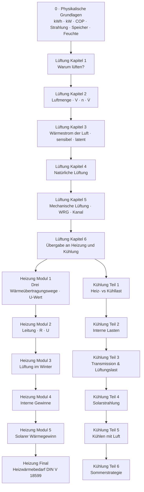

# Gebäudeenergie — Konzepte, Definitionen & Formeln

Referenz zu den Tutorial-Videos unter `🎓️teaching/🏛️architecture/⚡️energy/`.
Jedes Kapitel fasst **Lernziel**, **Kernbegriffe**, **Formeln** und **Merksätze** zusammen — parallel zu den Manim-Animationen.

---

## Curriculum-Übersicht

| # | Video | Ordner | Normen (Auswahl) |
|---|-------|--------|------------------|
| 0 | Physikalische Grundlagen | `1_physical_fundamentals/` | DIN EN 12831, DIN V 18599, DIN EN 14511, VDI 4650, DIN EN 410, DIN 4108-2/-3, DIN EN ISO 13786, DIN 1946-6 |
| L1–L6 | Lüftung (6 Kapitel) | `2_ventilation/` | DIN EN 12831-1, DIN V 18599, DIN 1946-4, DIN 1946-6, DIN EN 16798-1, DIN 4108-2 |
| H1–H5 | Heizwärmebedarf (5 Module) | `3_heating/` | DIN EN ISO 6946, DIN EN 12831, DIN V 18599 |
| HF | Heizwärmebedarf — Bilanz | `3_heating/6_final_calculation/` | DIN V 18599 |
| C1–C6 | Kühllast (6 Teile) | `4_cooling/` | DIN V 18599, VDI 2078 (implizit) |

---

## 0 · Physikalische Grundlagen

**Titel:** Physikalische Grundlagen
**Datei:** `../🧲️physics/🎬️clip/🧲️fundamentals/🐍️.py` · **8 Beats** (Reihenfolge: `BEATS` in `🐍️.py`)

### Lernziel

Die Größen der Gebäudeenergie konkret und visuell verstehen — immer am Bauteil, das sie bestimmt: **Energie (kWh)** im Alltag, **Leistung (kW)** als Fläche im Leistung-Zeit-Diagramm, **Energieerhaltung**, **Wärmepumpe/COP** im Vergleich zu anderen Heizsystemen, **Strahlung** am Glas, **thermische Masse** der Decke und **sensible/latente Wärme** — am Ende fasst eine Zusammenfassung die sieben Bausteine zusammen.

### Beat-Übersicht

| Beat | Untertitel | Inhalt |
|------|------------|--------|
| 1 | Energie im Alltag — die Kilowattstunde | Zähler · weggelassenes „h“ · 1 kWh = Staubsauger 1 h = ≈ 3 min warm duschen · Energie-Skala Teelicht → Welt · Glas, Decke, Öffnungen |
| 2 | Leistung — wie schnell Energie fließt | E = P · t als Fläche · Staubsauger/Wasserkocher/Dusche · 1 W = 1 J/s · Leistungs-Skala Teelicht → alle Kraftwerke · Heizlast vs. Heizwärmebedarf |
| 3 | Energie bleibt erhalten — jedes Watt wird Wärme | E_ein = E_aus + ΔE_Speicher · Lampe 5 % Licht + 95 % Wärme → 100 % Wärme · Mensch 100 W · Winter/Sommer |
| 4 | Wärmepumpe — Energie auf höheres Temperaturniveau übertragen | Kältekreis animiert · 1 + 3 = 4 · COP aus Balken · COP(Außentemperatur) · JAZ · Vergleich Holz, Öl, Gas, Elektro, Luft-/Erd-WP |
| 5 | Strahlung — kurzwellig hinein, langwellig gefangen | g-Wert aus Strahlen · Q̇_S = g · A · I · langwellige Rückstrahlung, Low-E · Treibhauseffekt · Sonnenschutz außen |
| 6 | Thermische Masse — speichern und zeitversetzt abgeben | Q = m · c · ΔT an 1 m² Betondecke · 24-h-Verlauf, Phasenverschiebung, Dämpfung · warum die Decke · Nachtlüftung/Sonnengewinne |
| 7 | Sensible und latente Wärme | T-Q-Diagramm Wasser · Sättigungskurve x_s(ϑ) · Taupunkt · Mensch 70 W sensibel + 30 W latent · Tauwasser/Entfeuchtung |
| 8 | Zusammenfassung — was wir gelernt haben | Sieben Zeilen, eine je Baustein: 1 kW · 1 h = 1 kWh · P = E / t · E_ein = E_aus + ΔE_Speicher · COP = Q_H / W_el · Q̇_S = g · A · I · Q = m · c · ΔT · Q_lat = m · r · Überleitung zu Heizung und Kühlung |

### Kernbegriffe

| Begriff | Definition | Was ist „1 …“? |
|---------|------------|----------------|
| **Kilowattstunde (kWh)** | Energie / verrichtete Arbeit: 1 kW eine Stunde lang | Staubsauger 1 h · ≈ 3 min warm duschen (30 l von 10 auf 38 °C) |
| **Kurzform** | Im Alltag fällt oft das „h“ weg („4 000 kW verbraucht“) | ohne „h“ ist es eine Leistung, keine Menge |
| **Kilowatt (kW)** | Leistung = Energie pro Zeit | Staubsauger ≈ 1 kW · Wasserkocher 2 kW · Durchlauferhitzer 18–24 kW |
| **Watt (W)** | 1 J pro Sekunde | 1 kWh = 1 000 W · 3 600 s = 3,6 Mio. J |
| **Joule (J)** | Energie: 1 W eine Sekunde lang | 1 kWh = 3,6 Mio. J |
| **Heizlast** | Spitzenleistung der kältesten Stunde | EFH ≈ 8 kW, DIN EN 12831 |
| **Heizwärmebedarf** | Fläche unter der Leistungskurve übers Jahr | EFH ≈ 15 000 kWh/a, DIN V 18599 |
| **COP** | Heizwärme / Strom in einem Betriebspunkt | 1 kWh Strom + 3 kWh Umweltwärme = 4 kWh, DIN EN 14511 |
| **JAZ** | Jahresarbeitszahl, COP übers Jahr | Luft-WP ≈ 3, Erd-WP ≈ 4, VDI 4650 |
| **g-Wert** | Anteil der Solarstrahlung, der durchs Glas kommt | Dreifachverglasung ≈ 0,5, DIN EN 410 |
| **kurz-/langwellig** | Sonne: Licht und nahes IR · warme Flächen: fernes IR | Glas lässt kurzwellig durch, langwellig kaum (Low-E reflektiert) |
| **Thermische Masse** | Wärmespeicher eines Bauteils, Q = m · c · ΔT | 1 m² Beton, 10 cm, 2 K → 480 kJ ≈ 0,13 kWh |
| **Phasenverschiebung φ** | Zeitversatz der Temperaturspitze durch Speichermasse | massive Decke ≈ 6 h (schematisch), DIN EN ISO 13786 |
| **sensible Wärme** | ändert die Temperatur | 1 kg Wasser 0 → 100 °C: 419 kJ |
| **latente Wärme** | steckt im Phasenwechsel, Temperatur bleibt | Verdampfen 1 kg Wasser: 2 257 kJ |
| **Taupunkt** | Temperatur, bei der φ = 100 % erreicht wird | 20 °C / 50 % → ≈ 9,3 °C, DIN 4108-3 |

### Formeln

| Formel | Bedeutung |
|--------|-----------|
| **1 kW · 1 h = 1 kWh** | Kilowatt mal Stunde |
| **Q = m · c · ΔT** | sensible Wärme (Dusche, Betondecke, Wasser) |
| **E = P · t**, **P = E / t** | Energie = Fläche im Leistung-Zeit-Diagramm |
| **1 W = 1 J/s**, **1 kWh = 3,6 · 10⁶ J** | Grundeinheit und Umrechnung |
| **E_ein = E_aus + ΔE_Speicher** | 1. Hauptsatz für einen Raum |
| **P_el = P_Licht + P_Wärme** | 100 W = 5 W + 95 W → am Ende 100 W Wärme |
| **COP = Q_H / W_el** | 4 kWh / 1 kWh = 4 |
| **Q̇_S = g · A · I** | 0,5 · 2,0 m² · 500 W/m² = 500 W |
| **m = ρ · A · d** | 2 400 kg/m³ · 1 m² · 0,10 m = 240 kg |
| **Q_lat = m · r** | 1 kg · 2 257 kJ/kg |
| **A₁ · v₁ = A₂ · v₂**, **p + ½ ρ v² = konstant** | Kontinuität und Bernoulli |

### Skalen

| Energie | Beispiel |
|---------|----------|
| ≈ 0,1 kWh | Teelicht |
| 1 kWh | Staubsauger 1 Stunde |
| ≈ 3 000 kWh | Haushaltsstrom pro Jahr |
| ≈ 15 000 kWh | Heizwärme Einfamilienhaus pro Jahr |
| ≈ 2,4 · 10¹² kWh | Deutschland pro Jahr, Endenergie |
| ≈ 1,7 · 10¹⁴ kWh | Welt pro Jahr, Primärenergie |

| Leistung | Beispiel |
|----------|----------|
| ≈ 30 W | Teelicht |
| ≈ 100 W | Mensch in Ruhe (≈ 70 W sensibel + 30 W latent) |
| ≈ 1 kW | Staubsauger |
| ≈ 8 kW | Einfamilienhaus, kältester Tag |
| ≈ 100 kW | Auto |
| ≈ 5 MW | Windrad |
| ≈ 1,4 GW | Kraftwerksblock |
| ≈ 9 TW | alle Kraftwerke der Welt (installiert) |

| Nutzwärme aus 1 kWh Endenergie | Wert |
|--------------------------------|------|
| Holzhackschnitzel | ≈ 0,85 |
| Heizöl Brennwert | ≈ 0,94 |
| Erdgas Brennwert | ≈ 0,96 |
| Elektroheizstab | 1,0 |
| Luft-Wärmepumpe (JAZ) | ≈ 3 |
| Erd-Wärmepumpe (JAZ) | ≈ 4 |

### Merksätze

- Im Alltag ist die **kWh** die wichtigste Größe — eine Energiemenge. Das „h“ nicht weglassen.
- **Leistung × Zeit = Fläche = Energie**; dieselbe kWh kann schnell (Dusche, 20 kW) oder langsam (Staubsauger, 1 kW) fließen.
- Fast jedes Watt im Gebäude endet als **Wärme** — im Winter Gewinn, im Sommer Last.
- Die Wärmepumpe **überträgt** Umweltenergie auf ein höheres Temperaturniveau; Brennstoffe verlieren am Haus einen Teil mit dem Abgas, Strom verursacht gegebenenfalls anderswo Abgas.
- Glas lässt **kurzwellig** hinein und hält **langwellig** zurück — Sonnenschutz gehört nach außen.
- Die **Decke** ist der wirksamste Speicher: frei, von warmer Luft angeströmt, im Strahlungsaustausch mit allen Flächen.
- **Latente** Wärme ist unsichtbar, aber groß; kühle Flächen unter dem Taupunkt bekommen Tauwasser.
- Durch die **Öffnungen** strömt Luft; jeder m³ trägt Wärme mit.

---

## L · Lüftung — Luftmenge, Wärmestrom der Luft, natürlich und mechanisch

**Titel:** Lüftung
**Dateien:** `2_ventilation/1_warum_lueften/` … `2_ventilation/6_uebergabe/` · **6 Kapitel, 22 Beats** (Reihenfolge: `VENTILATION_PLAYLIST` in `../🌬️ventilation/🎬️clip/🐍️.py`)

### Lernziel

Lüftung wird **einmal und jahreszeitenneutral** erklärt, weil sie Heizung und Kühlung gleichermaßen betrifft: Der Luftwechsel bringt im Winter Wärmeverlust, im Sommer Wärme- und Feuchtelast. Heizung und Kühlung setzen danach nur ihre Jahreszeit in dieselbe Formel ein.

### Kapitel und Beats

| Kapitel | Beats | Inhalt |
|---------|-------|--------|
| 1 · Warum lüften? | Lüftungsbedarf · Lüftungsweg · Fahrplan | CO₂ (≈ 420 ppm außen, 1 000 ppm Pettenkoferwert), Feuchte, Schadstoffe · 4 Personen · 30 m³/h = 120 m³/h · Richtung der Luft kehrt mit der Jahreszeit um |
| 2 · Wie viel Luft? | Innenvolumen · Luftwechselrate · Volumenstrom | V_e = 580 m³ → V ≈ 0,76 · V_e ≈ 440 m³ · n = 0,5 h⁻¹ → V̇ = V · n = 220 m³/h = 0,061 m³/s = q_v,R |
| 3 · Was die Luft trägt | Luftwärme · sensible Wärme · latente Last · Winter und Sommer | c_Luft ≈ 0,34 Wh/(m³·K) · Winter 1 500 W Verlust · Sommer 450 W sensibel + 810 W latent |
| 4 · Natürliche Lüftung | Fensterregeln · Stoß oder Kipp · Querlüftung · Auftrieb · Nachtlüftung · Grenzen | Fenster als Regler · 340 Wh gegen ≈ 780 Wh · 1/A_eff² = 1/A₁² + 1/A₂² · Δp = h · g · (ρ_a − ρ_i) |
| 5 · Mechanische Lüftung und WRG | Grundtypen · Wärmerückgewinnung · Anlagenvergleich · Kanalquerschnitt | η_WRG = (θ_ZUL − θ_AUL) / (θ_ABL − θ_AUL) · Winter 1 500 → 300 W · Sommer sensibel 450 → 90 W, latent bleibt · A = q_v,R / v_m, r = √(A/π) |
| 6 · Übergabe | Zusammenfassung · Übergabe an Heizung und Kühlung | alle Größen als eine Kette; was Heizung und Kühlung übernehmen |

### Kernbegriffe

| Begriff | Definition | Zahl im Laufbeispiel |
|---------|------------|----------------------|
| **Nettovolumen V** | beheiztes Luftvolumen ohne Konstruktion | ≈ 440 m³ |
| **Luftwechselrate n** | wie oft das Luftvolumen pro Stunde ausgetauscht wird [h⁻¹] | 0,5 h⁻¹ (Wohnung, DIN EN 12831) |
| **Volumenstrom V̇ = q_v,R** | Luft pro Zeit; Heizung schreibt V · n, Kühlung q_v,R | 220 m³/h = 0,061 m³/s |
| **c_Luft** | volumenbezogene Wärmekapazität, ρ · c_p / 3 600 | ≈ 0,34 Wh/(m³·K) |
| **Δθ** | Temperaturdifferenz innen − außen, mit Vorzeichen | Winter 20 K · Sommer −6 K (Gewinn) |
| **Δx** | Differenz der absoluten Feuchte | 4,5 g/kg (15,0 gegen 10,5 g/kg) |
| **η_WRG** | Temperaturänderungsgrad der Wärmerückgewinnung | 0,8 |

### Formeln

| Formel | Bedeutung |
|--------|-----------|
| **V̇ = V · n** | Luftvolumenstrom [m³/h], ÷ 3 600 gibt m³/s |
| **c_Luft = ρ · c_p / 3 600** | 1,2 · 1 005 / 3 600 ≈ 0,34 Wh/(m³·K) |
| **Q̇_V,sens = V̇ · c_Luft · Δθ** | sensible Lüftungsleistung; Winter 440 · 0,5 · 0,34 · 20 ≈ 1 500 W |
| **Q̇_V,lat = ρ · r · Δx · q_v,R** | latente Last; 1,2 · 2 450 kJ/kg · 4,5 g/kg · 0,061 m³/s ≈ 810 W |
| **Q̇_V,sens · (1 − η_WRG)** | mit Wärmerückgewinnung; 1 500 → 300 W, 450 → 90 W |
| **q_v,R = v_m · A**, **r = √(A/π)** | Kanal: 0,061 m³/s bei 2,5 m/s → A ≈ 0,0244 m², r ≈ 0,088 m |

### Übergabe

| Video | übernimmt aus der Lüftung |
|-------|---------------------------|
| **Heizung** | Φ_V = Q̇_V,sens als Lüftungsterm der Heizlast (1 500 W, mit WRG 300 W); Stoß- statt Kipplüftung |
| **Kühlung** | Q̇_L = sensibel + latent (450 W + 810 W), V̇ als Auslegungsgröße für Luftmenge und Kanal, Nachtlüftung als Speicherentladung, Kälterückgewinnung |

### Merksätze

- Der **hygienische Luftbedarf** besteht im Winter wie im Sommer — deshalb steht die Lüftung vor Heizung und Kühlung.
- **V̇ = V · n** und **q_v,R** sind derselbe Volumenstrom, nur anders geschrieben.
- Die Luft trägt Wärme **und** Feuchte: Heizung zählt nur den sensiblen Anteil, Kühlung beide.
- Ein **offenes Fenster** gewinnt nichts zurück (η = 0); erst die Zu-/Abluftanlage kann η_WRG nutzen.
- Der **Plattentauscher** gewinnt nur sensible Wärme zurück — die latente Last bleibt und braucht Entfeuchtung.

---

## Heizung · Modul 1 — Die Grundlagen der Bauphysik

**Datei:** `../🔥️heating/🎬️clip/🧲️fundamentals/🐍️.py`

### Lernziel

Die drei Wärmeübertragungsmechanismen an derselben Gebäudewand verstehen und in Kennzahlen (R, U, Q̇) übersetzen.

### Kernbegriffe

| Begriff | Definition |
|---------|------------|
| **Wärmeleitung (Q̇_k)** | Energie wandert durch festes Material; Moleküle bleiben am Platz |
| **Konvektion (Q̇_c)** | **Bewegte Luft** trägt Wärme: eine geschlossene Luftwalze, am Heizkörper erwärmt, an der kalten Außenwand abgekühlt; außen nimmt der Wind sie mit. Den Luftaustausch mit außen erklärt das Lüftungsvideo |
| **Strahlung (Q̇_r)** | Infrarotwellen von Fläche zu Fläche, **kein Medium** nötig (Heizkörper → Wand, Außenwand → Nachthimmel) |
| **Δθ** | Temperaturdifferenz — einziger Antrieb des Wärmestroms (warm → kalt) |
| **Wärmedurchlasswiderstand R** | Bremswirkung einer Schicht [m²·K/W] |
| **U-Wert** | Kehrwert des Gesamtwiderstands — wie leicht Wärme hindurchkommt [W/(m²·K)] |
| **λ (Lambda)** | Wärmeleitfähigkeit des Materials [W/(m·K)] |

### Formeln

| Formel | Bedeutung |
|--------|-----------|
| **Q̇_c,i + Q̇_r,i = Q̇_k = Q̇_c,e + Q̇_r,e** | Derselbe Wärmestrom durchläuft Innenoberfläche, Wand und Außenoberfläche nacheinander |
| **R = d / λ** | Widerstand einer Schicht |
| **R_ges = R_si + Σ(d/λ) + R_se** | Gesamtwiderstand inkl. Oberflächenwiderständen |
| **U = 1 / R_ges** | U-Wert |
| **Q̇ = U · A · Δθ** | Wärmestrom durch Bauteil [W] |

### Merksätze

- Energie wandert **nur von warm nach kalt** (2. Hauptsatz).
- DIN EN ISO 6946 fasst Leitung, Konvektion und Strahlung zu **einem U-Wert** pro Bauteil zusammen.
- Temperatur fällt in Stufen: 20 °C Luft → 16,3 °C Innenoberfläche → 1,1 °C Außenoberfläche → 0 °C (U = 1,43).
- **Nur U ist eine Entwurfsentscheidung** — Dämmung ist der Hebel (A und Δθ sind gegeben).

---

## Heizung · Modul 2 — Wärmeleitung (Transmission)

**Datei:** `../🔥️heating/🎬️clip/🧱️conduction/🐍️.py`

### Lernziel

Vom makroskopischen Temperaturgradienten zum mikroskopischen Molekülschwingen — zur Berechnung von R und U an mehrschichtigen Wänden, zum Wärmestrom der ganzen Hülle und zu den Wärmebrücken, die die vereinfachte Flächenrechnung erzeugt.

### Kernbegriffe

| Begriff | Definition |
|---------|------------|
| **Temperaturgradient** | Temperaturabfall über die Schichtdicke |
| **Mehrschichtenaufbau** | Putz · Mauerwerk · Dämmung · Außenputz — jede Schicht eigenes R |
| **U-Wert je 1 m²** | Watt durch genau 1 m² Bauteil bei 1 K — die Dicke steckt schon über R = d/λ im U-Wert |
| **Bauteilfläche A_i** | Fläche der i-ten Hüllenfläche — vervielfacht den 1-m²-Wert |
| **Wärmebrücke** | Ecke, Anschluss oder Durchdringung, an der die Papier-Abstraktion der Wand nicht stimmt |
| **Ψ (Psi)** | längenbezogener Wärmedurchgangskoeffizient einer Wärmebrücke [W/(m·K)] |
| **ΔU_WB** | pauschaler Wärmebrückenzuschlag auf die ganze Hüllfläche [W/(m²·K)] |

### Formeln

| Formel | Bedeutung |
|--------|-----------|
| **R = d / λ** | pro Schicht |
| **U = 1 / R_ges** | Wärmestrom je 1 m² und 1 K |
| **H = U · A** | 1-m²-Wert mal Anzahl Quadratmeter [W/K] |
| **Φ_T = Σ (U_i · A_i · Δθ_i)** | Transmissionswärmestrom der Hülle [W] |
| **H_T = Σ U_i·A_i + Σ Ψ_k·l_k** | mit Wärmebrücken (detailliert) |
| **H_T = Σ U_i·A_i + ΔU_WB · A** | mit Wärmebrücken (pauschal, ΔU_WB = 0,10 bzw. 0,05 nach DIN 4108 Beiblatt 2) |

### Wattvergleich (25 m² Wand, Δθ = 20 K)

| Wand | U [W/(m²·K)] | Wärmestrom | Vergleich |
|------|--------------|-----------|-----------|
| Ungedämmte Ziegelwand 36,5 cm | ≈ 1,43 | ≈ 715 W | ≈ 0,7 Toaster |
| + 12 cm Dämmung | ≈ 0,24 | ≈ 120 W | ≈ ein ruhender Mensch |
| + 30 cm Dämmung | ≈ 0,11 | ≈ 55 W | ≈ zwei Teelichter |

### Merksätze

- Dicker oder besser gedämmt → **R steigt**, **Q̇ sinkt**.
- Altbau-Massivwand U ≈ 1,43 vs. saniert mit 20 cm Dämmung U ≈ 0,16 (≈ Faktor 9).
- Wird mit **Außenmaßen** gerechnet, zählt die Ecke doppelt → Ψ negativ (Abschlag); mit **Innenmaßen** fehlt sie → Ψ positiv (Zuschlag).

---

## Heizung · Modul 3 — Lüftung im Winter

**Datei:** `../🔥️heating/🎬️clip/🌬️convection/🐍️.py` · **1 Beat** (`Beat1_LueftungImWinter`)

### Lernziel

Die Lüftungswärmeverluste aus dem Lüftungsvideo (`2_ventilation/`) mit einer kurzen Erinnerung in die Heizlast einsetzen: V̇ = V · n, c_Luft und das winterliche Δθ ergeben Φ_V, das neben dem Transmissionsverlust aus Modul 2 steht. Luftmenge, Stoß- und Kipplüftung, Wärmerückgewinnung und Anlagenvergleich werden dort erklärt.

### Formeln

| Formel | Bedeutung |
|--------|-----------|
| **Φ_V = V · n · c_Luft · Δθ** | Lüftungswärmeverlust ohne WRG; 440 · 0,5 · 0,34 · 20 ≈ 1 500 W |
| **Φ_V = V · n · (1 − η_WRG) · c_Luft · Δθ** | mit Wärmerückgewinnung η_WRG = 0,8: ≈ 300 W |

### Merksätze

- Φ_T ≈ 2 300 W plus Φ_V ≈ 1 500 W ergibt 3 800 W; mit WRG bleiben 2 600 W.
- Die Bausteine V, n, c_Luft, Δθ und η_WRG stammen aus dem Lüftungsvideo (Kapitel 2, 3 und 5).

---

## Heizung · Modul 4 — Interne Wärmegewinne

**Datei:** `../🔥️heating/🎬️clip/👥️internal-gains/🐍️.py`

### Lernziel

Personen, Geräte und Beleuchtung als Wärmequellen im Winter (Gewinn) erfassen.

### Kernbegriffe

| Begriff | Definition |
|---------|------------|
| **Φ_P** | Wärmegewinn durch Personen |
| **Φ_E** | Wärmegewinn durch Geräte (elektrische Leistung × Nutzungsfaktor) |
| **Φ_L** | Wärmegewinn durch Beleuchtung |
| **Φ_int** | Summe interner Gewinne |
| **A_N** | Nutzfläche [m²] |

### Formeln

| Formel | Bedeutung |
|--------|-----------|
| **Φ_int = Φ_P + Φ_E + Φ_L** | Gesamte interne Wärmegewinne [W] |
| **q_int = Φ_int / A_N** | Spezifische interne Gewinnleistung [W/m²] |

### Merksätze

- Ruhende Person ≈ **80–100 W** thermisch (≈ Glühbirne).
- Im Winter senken interne Gewinne die **Heizlast**; im Sommer erhöhen sie die **Kühllast**.

---

## Heizung · Modul 5 — Solarer Wärmegewinn

**Datei:** `../🔥️heating/🎬️clip/☀️solar-gains/🐍️.py`

### Lernziel

Solare Einstrahlung durch transparente Bauteile, g-Wert, Verschattung, Speichermasse und die solare Hauptgleichung.

### Kernbegriffe

| Begriff | Definition |
|---------|------------|
| **G** | Gesamtsonneneinstrahlung auf geneigte Fläche [W/m²] |
| **A** | Fläche des Bauteils [m²] |
| **F_f** | Rahmenanteil (nicht transparent) |
| **g** | Gesamtenergiedurchlassgrad der Verglasung |
| **F_sh** | Verschattungsfaktor — besonnter Anteil der Glasfläche, 1 = frei, 0 = ganz verschattet |
| **Speichermasse** | Schwere Innenschichten puffern Temperatur (Trägheit) |

### Formeln

| Formel | Bedeutung |
|--------|-----------|
| **Φ_solar = G · A · F_f · g · F_sh** | Solarer Wärmegewinn [W] |

### Merksätze

- Niedriger **g-Wert** = weniger solare Wärme durchs Fenster (Sommer wichtig).
- Verschattung und Speichermasse **verschieben** den Lastspitzen-Zeitpunkt.
- Sonnenstrahlen sind **parallel** und fallen vom Fenster nach unten: im Winter liegt der Sonnenfleck auf dem Boden, die obere Raumecke gegenüber bleibt unbeschienen.

---

## Heizung · Final Calculation — Heizwärmebedarf

**Datei:** `../🔥️heating/🎬️clip/🧮️calculation/🐍️.py`

### Lernziel

Alle Verlust- und Gewinnpfade in **einer Bilanz** zusammenführen → Jahres-Heizwärmebedarf.

### Formeln

| Formel | Bedeutung |
|--------|-----------|
| **Φ_T = Σ U · A · Δθ** | Transmissionsverluste |
| **Φ_V = V · n · c_Luft · Δθ** | Lüftungsverluste |
| **Φ_Verlust = Φ_T + Φ_V** | Gesamtwärmeverlustleistung |
| **Q_Verlust = (H_T + H_V) · G_t · 24 h/d** | Jahreswärmeverlust aus Gradtagzahl |
| **Q_h = Q_Verlust − η_h · (Q_sol + Q_int)** | **Heizwärmebedarf** (DIN V 18599) |
| **Q_E = Q_h + Q_h,ce + Q_h,d + Q_h,s + Q_h,g** | Endenergie mit Übergabe-, Verteilungs-, Speicher- und Erzeugungsverlusten (DIN V 18599-5) |

### Kernbegriffe

| Begriff | Definition |
|---------|------------|
| **η_h** | Ausnutzungsgrad der Gewinne — Anteil der Gewinnfläche unter der Verlustkurve; schwere Bauweise speichert den Überschuss und hebt η_h |
| **Q_h** | Heizwärmebedarf — Energie, die aktiv zugeführt werden muss |
| **Anlagenverluste** | Rohre im unbeheizten Keller, Speicher, Heizkörper an der Außenwand und der Erzeuger verlieren Wärme auf dem Weg |

### Merksätze

- **Heizlast (kW)** = Dimensionierung für den kältesten Moment (DIN EN 12831, Hannover −12 °C).
- **Heizwärmebedarf (kWh/m²a)** = Jahresenergiebilanz (DIN V 18599).

---

## Kühlung · Teil 1 — Heizlast vs. Kühllast

**Datei:** `../❄️cooling/🎬️clip/⚖️heating-comparison/🐍️.py`

### Lernziel

Dieselben Gewinnequellen (Sonne, Personen, Geräte) **saisonal unterschiedlich** bewerten: Winter = Hilfe, Sommer = Problem.

### Kernbegriffe

| Begriff | Definition |
|---------|------------|
| **Heizlast** | Fehlende Wärmeleistung im Winter |
| **Kühllast** | Zu entfernende Wärmeleistung im Sommer |
| **Interne Gewinne** | Personen (~100 W), Laptop (~60 W), Beleuchtung |

### Merksätze

- **Gleiches Haus, gleiche Gewinne — gegenteilige Wirkung** je nach Jahreszeit.
- Kühlsystem muss interne + solare Gewinne **abführen**, nicht nur Außenhitze.

---

## Kühlung · Teil 2 — Interne Wärmegewinne

**Datei:** `../❄️cooling/🎬️clip/👥️internal-gains/🐍️.py`

### Lernziel

Interne Lasten detailliert aufschlüsseln. Sensible und latente Wärme erklärt das Lüftungsvideo (Kapitel 3); hier nennt Teil 2 nur, dass Personen beides abgeben.

### Formeln

| Formel | Bedeutung |
|--------|-----------|
| **Q̇_Pers = n · q̇_p** | Personenlast [W] |
| **Q̇_Geräte = P_el · f_N** | Gerätelast (Leistung × Nutzungsfaktor) |
| **Q̇_Licht = P_Licht · f_g** | Beleuchtungslast |
| **Q̇_i = Q̇_Pers + Q̇_Geräte + Q̇_Licht** | Gesamte interne Last |

### Körperwärme nach Aktivität (q̇_p-Skala)

| Aktivität | Abgabe |
|-----------|--------|
| Schlafen | ≈ 80 W |
| Büroarbeit (sitzend) | ≈ 100 W |
| Gehen | ≈ 200 W |
| Hochleistungssport | ≈ 800 W |

### f_N nach Nutzung (Anteil gleichzeitig laufender Geräte)

| Nutzung | f_N |
|---------|-----|
| Büro | ≈ 0,7 |
| Serverraum | 1,0 |
| Besprechungsraum | ≈ 0,3 |

### Merksätze

- Hörsaal mit 100 Personen: **~10 kW** interne Wärme — massive Sommerlast.
- Latente Last = Feuchte (Schwitzen, Atmung) — braucht **Entfeuchtung**, nicht nur Kühlung (Lüftungsvideo, Kapitel 3).
- f_g (Beleuchtung) analog zu f_N: Anteil der **gleichzeitig betriebenen** Leuchten (2 Leuchten, 1 aus → f_g = 0,5).

---

## Kühlung · Teil 3 — Transmission & Lüftungslast

**Datei:** `../❄️cooling/🎬️clip/💧️transmission-humidity/🐍️.py` · **3 Beats** (Opake Bauteile · Phasenverschiebung · Lüftungslast im Sommer)

### Lernziel

Sommerliche Transmissionslast (mit ΔT_eq für solare Aufheizung, Zeitverzögerung) und — als kurze Erinnerung, ohne Herleitung — die Lüftungslast aus dem Lüftungsvideo (450 W sensibel + 810 W latent) neben der Transmission im Lastbalken.

### Formeln

| Formel | Bedeutung |
|--------|-----------|
| **Q̇_T = U · A · ΔT_eq** | Transmissionskühllast (opake Bauteile, Sommer) |
| **Q̇_L = Q̇_V,sens + Q̇_V,lat** | Lüftungslast aus dem Lüftungsvideo (Kapitel 3); 450 W + 810 W ≈ 1 260 W |

### Kernbegriffe

| Begriff | Definition |
|---------|------------|
| **ΔT_eq** | Äquivalente Temperaturdifferenz (solare Oberflächenaufheizung) |
| **Zeitverzögerung** | Schwere Wände puffern — Last kommt **verspätet** |

### Merksätze

- Luftmenge, c_Luft, Δx und Rückgewinnung werden im Lüftungsvideo (Kapitel 2, 3, 5) erklärt; hier steht die Last neben der Transmission.
- Ein Plattentauscher gewinnt nur sensible Wärme zurück (450 → 90 W); die latente Last bleibt und braucht Entfeuchtung.

---

## Kühlung · Teil 4 — Solarstrahlung

**Datei:** `../❄️cooling/🎬️clip/☀️solar-radiation/🐍️.py`

### Lernziel

Solare Kühllast durch Fenster: Einstrahlung, Rahmen, Verschattung, Verglasung.

### Formeln

| Formel | Bedeutung |
|--------|-----------|
| **I_S,max ≈ 800 W/m²** | Max. solare Einstrahlung (Größenordnung) |
| **A_eff = A · F_F** | Effektive Glasfläche (ohne Rahmen) |
| **I_reduziert = I_S,max · F_V** | Nach Verschattung |
| **g_tot = τ_e + q_i** | Gesamtenergiedurchlassgrad |
| **Q̇_S,tr = A · F_F · F_V · g_tot · I_S,max** | Solare Transmissionskühllast |

### Kernbegriffe

| Begriff | Definition |
|---------|------------|
| **F_F** | Rahmenflächenanteil |
| **F_V** | Verschattungsfaktor (Außen-/Innenschatten) |
| **τ_e** | Transmissionsgrad der Verglasung |
| **q_i** | Absorptionsanteil der Verglasung |

---

## Kühlung · Teil 5 — Systemauslegung

**Datei:** `../❄️cooling/🎬️clip/📐️system-sizing/🐍️.py` · **2 Beats** (Volumenstrom-Gleichung · Luftstrom isolieren)

### Lernziel

Von der Kühllast zum erforderlichen **Luftvolumenstrom** — und der Vergleich mit dem hygienischen Volumenstrom aus dem Lüftungsvideo. Der Kanalquerschnitt folgt mit derselben Methode wie dort (Kapitel 5), nur größer.

### Formeln

| Formel | Bedeutung |
|--------|-----------|
| **Q̇_V = ρ_a · c_p,a · Δθ · q_v,R** | Volumenstrom-Kühlleistung |
| **q_v,R = Q̇_S,tr / (ρ_a · c_p,a · Δθ)** | Erforderlicher Volumenstrom aus solarer Last (≈ 0,126 m³/s bei Q̇_S,tr ≈ 1 060 W, Δθ = 7 K) |
| **A = q_v,R / v_m** | Kanalquerschnitt: 0,0505 m² gegenüber 0,0244 m² beim hygienischen Volumenstrom |

### Merksätze

- Erst **Last isolieren** (solar getrennt von intern), dann Volumenstrom dimensionieren.
- Die Kühllast braucht etwa **das Doppelte** des hygienischen Volumenstroms (0,126 gegenüber 0,061 m³/s).

---

## Kühlung · Teil 6 — Sommerstrategie

**Datei:** `../❄️cooling/🎬️clip/🌤️summer-strategy/🐍️.py` · **3 Beats** (Last zuerst senken · Sorptionsgestützte Kühlung · Komfortstrategie)

### Lernziel

Strategie: Last senken → frei lüften, solange die Außenluft kühler ist → Maschinen als Reserve. Das ist sommerlicher Wärmeschutz (DIN 4108-2). Fenster-, Quer-, Auftriebs- und Nachtlüftung sowie die mechanischen Systeme und die Wärmerückgewinnung stehen im Lüftungsvideo (Kapitel 4 und 5).

### Strategie (3 Stufen)

1. **Hülle + Sonnenschutz** — Last senken (~45 %)
2. **Natürliche Lüftung** — kostenlos nutzen (~35 %), Kapitel 4 des Lüftungsvideos
3. **RLT als Reserve** — nur für den Rest der Kühllast (~20 %), Kapitel 5 des Lüftungsvideos

### Sorptionsgestützte Kühlung (DEC)

Kühlen allein mit Stoffeigenschaften — ohne Kältemaschine:

1. **Sorptionsrad** entfeuchtet die schwüle Außenluft (Sorptionswärme: Luft wird zunächst wärmer, z. B. 32 °C feucht → 48 °C trocken).
2. **Plattentauscher** gibt diese Wärme an die Abluft ab (→ ≈ 24 °C).
3. **Verdunstungskühlung** senkt die trockene Luft auf Zulufttemperatur (→ ≈ 19 °C) — nur möglich, *weil* sie vorher entfeuchtet wurde.
4. **Regeneration durch die Sonne:** Solarwärme treibt die gespeicherte Feuchte aus dem Rad in die Fortluft.

**Nachteil (mikrobiell):** krasse Temperatur- und Feuchtewechsel setzen Keime im Gerät unter Selektionsdruck — resistente Stämme überleben bevorzugt. Hygiene/Wartung einplanen.

### Merksätze

- **Komfort zuerst, Außenluft zweitens, Maschinen zuletzt.**
- Ein Passivhaus braucht Zu-/Abluft mit WRG; ein offenes Fenster hat η = 0 — die sommerliche Nachtlüftung bleibt als Ergänzung.

---

## Einheiten-Spickzettel

| Größe | Symbol | Einheit | Typ |
|-------|--------|---------|-----|
| Kraft | F | N | Vektor |
| Arbeit / Energie | W, E | J, kWh | Skalar |
| Leistung | P, Q̇, Φ | W, kW | Fluss (momentan) |
| Wärmedurchgangskoeffizient | U | W/(m²·K) | Material/Bauteil |
| Wärmedurchlasswiderstand | R | m²·K/W | Material/Bauteil |
| Wärmeleitfähigkeit | λ | W/(m·K) | Material |
| Volumen | V | m³ | Geometrie |
| Luftwechselrate | n | h⁻¹ | Betrieb |
| Fläche | A | m² | Geometrie |
| Temperaturdifferenz | Δθ, ΔT | K | Treiber |

---

## Wasser-Analogie (durchgängig)

| Physik | Analogie |
|--------|----------|
| Leistung (kW) | Hahnstellung — wie schnell Wasser **gerade jetzt** fließt |
| Energie (kWh) | Wassermenge im Eimer nach einer Stunde Laufzeit |
| 1 kW · 1 h = 1 kWh | Ein Stunde lang gleichbleibender Fluss füllt genau einen Eimer |
| U-Wert (niedrig) | Dünnes Rohr / wenig Durchfluss |
| Wärmepumpe (COP) | Pumpe, die Wärme „hochhebt“ statt sie zu erzeugen |

---

*Stand: abgeleitet aus den Manim-Szenen in `🎓️teaching/🏛️architecture/⚡️energy/`. Bei Abweichungen gilt der Quellcode (`🐍️.py` → `NARRATION` + `equation_row`) als maßgeblich.*
